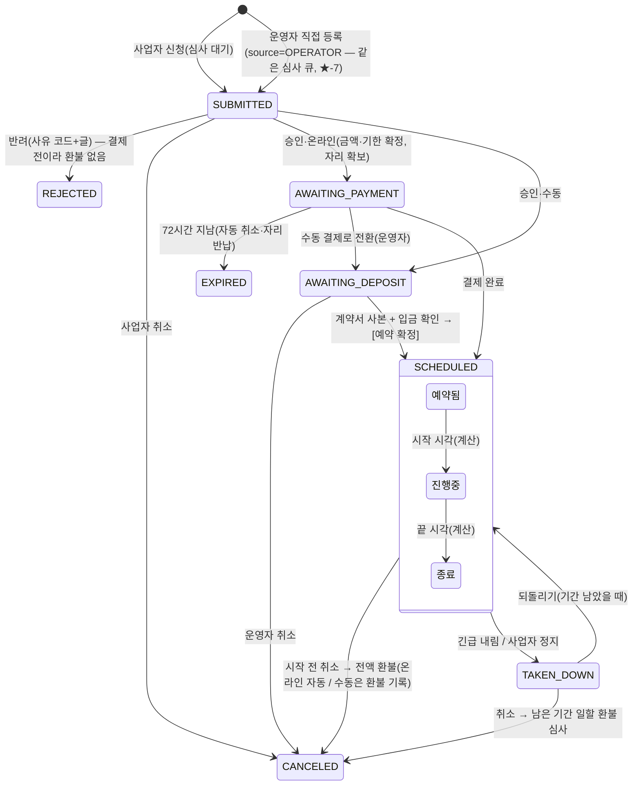

# 사업자등록 · 광고 · 핫딜 — 통합 분석 (2026-10-30, 검토 초안)

| 항목 | 값 |
|---|---|
| 목적 | 커뮤니티(`D:\project\community\workspace\community`)의 남은 세 영역을 로보얌으로 옮기기 전에 **보완점과 프로세스 끊김**을 찾고, 세 영역이 맞물리는 곳을 하나로 정한다 |
| 조각 | **00**(이 문서 — 통합·결정·단계·화면 지도) · [01 사업자등록](01-business.md) · [02 광고](02-ad.md) · [03 핫딜](03-hotdeal.md) |
| 상태 | **§★ 확정**(사용자 2026-10-30: 사전 심사 후 결제 · 수동 결제는 계약서 사본 + 입금 확인 · 🔴·끊김 보강). 목업 화면 진행 중(서버·계약 없음) |
| 다음 | 목업 확인 → 영역별 `docs/features/<기능>-contract.md` → 백엔드 |

## 0. 요약 (다섯 줄)

1. **커뮤니티는 세 영역 모두 코드·시험까지 거의 끝나 있다**(사업자 V36·V103, 광고 V99~V108, 핫딜 V35~V50). 그대로 옮기면 되는 것이 많지만, **사업자 진위 확인·환불 요청·소재 증빙·결제 이중화**처럼 처음부터 비어 있던 곳이 있다.
2. **세 영역은 사업자 하나에 매달린다.** 사업자 = 「신원 1줄 + 서비스별 이용 권한 N줄」(커뮤니티 V103 구조)을 로보얌의 주춧돌로 삼고, 광고·핫딜은 `approvedProfileOf(userId, service)` 판정 하나만 부른다.
3. **돈은 로보얌 `payment` 모듈 한 길로 받는다.** 커뮤니티는 입점권(핫딜)·홍보권(직접홍보)·광고(사이트 밖 입금)가 결제 코드를 따로 가졌다. 로보얌은 「사업자 상품」 표 하나 + `PaymentOrderType.BIZ_PRODUCT` 핸들러 하나로 합친다 → 커머스 테스트 필수 규칙이 그대로 적용된다.
4. **"광고처럼 보이는 노출"은 하나의 일정·한도 엔진으로.** 커뮤니티는 광고 건·핫딜 노출권·직접홍보 한 줄이 각각 한도 판정을 가졌다(되돌리기 비용 때문에 합치지 않음 — D-13). 로보얌엔 셋 다 아직 없으므로 **광고 건(유형별 한도·기간·긴급 내림) 하나로 합치는 것을 추천**한다.
5. **세 영역 모두 1차는 서로 기다리지 않고 시작할 수 있다**: 회원 핫딜 · 운영자 대행 광고 · 사업자 신원 심사. 사업자 결제·신청이 얽히는 일은 2차에 몰아서 한 번에 연결한다.

---

## ★ 확정 (사용자 2026-10-30) — 사전 심사 후 결제 · 수동 결제 · 🔴·끊김 보강

이 절이 아래 1~5절보다 우선한다. 1~5절의 "선결제(신청 때 결제)"·"입금 체크박스만" 표현은 이 절로 바뀐다.

### ★-1. 사업자 신청 건 — 광고·핫딜 모두 「사전 심사 → 결제」

- **사업자 광고와 사업자 핫딜은 모두 사전 심사를 신청해야 한다.** 결제는 **심사 승인 뒤에만** 받는다(돈을 먼저 받고 반려·환불하는 길을 없앤다 — 01·02·03 의 "반려 = 자동 환불" 끊김이 사라진다).
- 하나의 개념 **「사업자 신청 건」**(`biz_applications`)으로 받는다. 종류(`kind`):

| 종류 | 무엇 | 심사 대상 |
|---|---|---|
| `AD_BANNER` | 배너 광고(유형 4: 넓은·띠·네모·작은) | 소재(이미지·링크·대체 글)·기간·유형 |
| `AD_TEXT_LINE` | 한 줄 광고(직접홍보 한 줄 포함 — D2) | 문구·링크(또는 내 홍보 글)·기간 |
| `HOTDEAL_POST` | 사업자 핫딜 글 게시 | 딜 정보(링크·가격·몰·기간)·제목·본문 |
| `HOTDEAL_PLACEMENT` | 핫딜 노출(홈 상단·말머리 상단) | 연결할 핫딜 글·노출 자리·기간 |

- 회원 핫딜(일반 회원 글)은 심사하지 않는다(지금처럼 바로 게시 + 신고·종료 요청으로 관리).
- 커뮤니티의 「입점권 먼저 사고 → 글에 쓰기」 모델은 쓰지 않는다. **건마다 신청 → 심사 → 결제**다. 월 이용권·묶음권은 3차 검토.

### ★-2. 결제 두 길

| | 온라인 결제 | 수동 결제(계좌이체·계약) |
|---|---|---|
| 누가 고르나 | 사업자가 신청서 마지막 단계에서 고른다 / 운영자가 승인 때 바꿀 수 있다 | 같음. 운영자가 직접 등록하는 건은 늘 수동 |
| 승인 뒤 상태 | `AWAITING_PAYMENT`(결제 대기) | `AWAITING_DEPOSIT`(입금·계약 확인 대기) |
| 금액 | 운영자가 승인 때 확정(요금표 계산값 + 조정 시 사유 필수) | 같음(계약 금액) |
| 기한 | 결제 기한 **72시간**(설정값) | 입금 기한 운영자가 지정(기본 **7일**) |
| 확정 조건 | `payment` 모듈 결제 완료(`PaymentOrderType.BIZ_APPLICATION` 핸들러 `onPaid`) | **계약서 사본 첨부(필수, 1장 이상)** + **입금 확인**(입금액·입금일·입금자명·확인자) — **둘 다 있어야** [예약 확정]이 켜진다. 서버도 CHECK 로 막는다 |
| 기한 넘김 | 자동 취소 + 자리 반납 + 사업자 알림(배치) | 자동 취소하지 않고 운영자 「입금 기한 지남」 목록에 올림(운영자가 연장·취소) |
| 확정 뒤 | `SCHEDULED`(예약됨) → 시작 시각 `RUNNING` → 끝 `ENDED`(계산) | 같음 |

- **수동 결제 — 운영자 모드에서 광고 등록·진행**: 운영자가 관리자 화면에서 ① 사업자(또는 계정 없는 광고주)를 고르고 ② 종류·기간·소재를 넣고 ③ 계약서 사본을 올리고 ④ 입금을 확인하면 예약 확정 → 자동 시작. 사업자 신청 건을 「수동 결제로 전환」해 같은 화면으로 이어 갈 수도 있다.
- **계약서 사본**: PDF·JPG·PNG, 한 장 10MB, 여러 장. 원본 파일은 보존(교체 금지 — 새 파일을 더하고 옛 파일은 「대체됨」 표시), 열람은 권한(`ad.manage` 이상) + 열람 기록. 보존 기간: 계약 기록 **5년**(전자상거래법 시행령 제6조 계약·대금 기록 기준 — 법무 확인).
- **입금 확인 기록**: 입금액 ≠ 계약 금액이면 저장은 되지만 [예약 확정] 전에 경고 + 사유. 확인자·시각은 감사(`BIZ_DEPOSIT_CONFIRM`, 돈 관련 5년).
- **자리(한도) 잡는 시점**: 승인하는 순간부터 `AWAITING_PAYMENT`·`AWAITING_DEPOSIT` 도 한도를 차지한다(결제하는 사이 다른 건이 자리를 뺏지 않게). 기한이 지나 취소되면 반납. 승인 때 한도를 다시 판정한다.

### ★-3. 사업자 신청 건 상태



- 승인 뒤 결제 전에 사업자가 소재를 바꾸면 **다시 `SUBMITTED`**(재심사). 예약 확정 뒤 소재 교체는 운영자 「소재 교체 심사」를 거쳐 새 소재 버전으로(옛 버전 보존).

### ★-4. 🔴 보강 — 해결 방법 확정

| # | 🔴 문제 | 확정 해결 |
|---|---|---|
| B1 | 사업자등록번호 진위·휴폐업 확인 없음 | **승인 전 국세청 상태조회 필수.** 「계속사업자」만 [승인] 활성. 휴업·폐업이면 승인 잠금. 조회 장애·키 없음이면 「조회 불가」 표시 + 승인하려면 사유 필수(감사). 결과 스냅샷(조회 시각·상태·과세유형) 저장, 심사 화면에 [다시 조회] |
| B2 | 사업자등록증 첨부 없음 | 신청 폼에 **사업자등록증 사본 필수**(PDF·JPG·PNG 10MB). 열람 = 권한 + 기록. 반려·탈퇴 후 90일 파기, 승인 사업자는 이용 중 보존 |
| B3 | 정지 해제·평문 열람이 루트 전용 | 권한 코드 `business.reveal`·`business.unsuspend`(SENSITIVE)로. 평문 열람은 사유 필수 + 10분 뒤 자동 가림 + 기록(운영자·IP·사유) |
| A1 | 광고 코드 = XSS | 1차·2차는 **이미지 배너 + 링크만**. 광고 코드는 3차, CSP 와 함께 |
| A2 | 소재 교체 증빙 없음 | **소재 버전 표**(`biz_creative_versions`): 심사 승인 때 버전 고정, 교체는 새 버전(옛 파일 삭제 금지). 노출 집계는 버전 단위 |
| A3 | 사업자 모듈 의존 | 사업자 1차(신원·심사)를 먼저 끝낸다. 그 전에는 운영자 수동 등록(계정 없는 광고주)만 |
| H1 | 사업자가 환불을 요청할 길 없음 + 탈퇴 막힘 | 신청 건 상세에 **[취소·환불 요청]**: 결제 전 = 그냥 취소 / 시작 전 = **전액 자동 환불** / 진행 중 = 운영자 심사(남은 기간 일할 제안). 탈퇴 때 결제 전·시작 전 건은 자동 취소·환불하고 탈퇴 허용, 진행 중 건만 막음(또는 「남은 기간 포기」 동의) |
| H2 | 사업자 정지 때 선결제 건 처리 없음 | 정지 창에 영향 건수 표시 + 처리 선택(기본값): 결제 대기·입금 대기 = **자동 취소**, 시작 전 예약 = **전액 환불**, 진행 중 = **긴급 내림 + 일할 환불 심사 대기열**. 해제 때 진행 중이던 건은 운영자가 「남은 기간 연장 후 되돌리기」 또는 「환불 유지」 선택 |
| H3 | 결제 코드 이중화 | `payment` 모듈 한 길(`PaymentOrderType.BIZ_APPLICATION`). 웹훅·취소 재시도·대사·결제 이상은 `payment` 가 맡는다. 커머스 테스트 필수 규칙 적용 |
| H4 | 법적 지위·제휴 표기 우회 | 신청서 마지막 단계에 **환불 규정·광고 정책 동의**(버전 저장). 단축 URL 도메인 기본 차단, 공개 화면 「광고」 표시 + `rel="sponsored nofollow"`. 전자상거래법·표시광고법 적용 범위는 법무 확인 항목으로 유지 |

### ★-5. 끊긴 프로세스 — 보강 확정

| # | 끊김 | 확정 흐름 |
|---|---|---|
| F1 | 돈을 먼저 받고 반려하면 환불해야 함 | 사전 심사 → 승인 뒤 결제(★-1). 반려는 늘 결제 전 |
| F2 | 승인됐는데 결제·입금이 안 됨(자리만 차지) | 온라인 72시간 기한 → 자동 취소·자리 반납·알림. 수동은 입금 기한 목록에서 운영자가 연장·취소 |
| F3 | 수동 결제 근거 없음(입금 체크박스 하나) | 계약서 사본 + 입금 확인 기록 둘 다 있어야 예약 확정(서버 CHECK). 확인자·시각 감사 |
| F4 | 정지 때 영역마다 처리 다름(광고 자동 중단, 핫딜 기간만 흐름) | ★-4 H2 한 규칙으로 광고·핫딜 공통 |
| F5 | 운영 귀책 중단(긴급 내림·자리 중지) 보상 규칙 없음 | 되돌릴 때 운영자가 「중단된 시간만큼 끝 시각 연장」 또는 「일할 환불」 중 선택(기록). 사업자 귀책(정책 위반)은 환불 없음 — 사유 코드로 구분 |
| F6 | 심사 중 희망 기간이 지남 | 승인 창에서 시작이 지났으면 「기간을 같은 길이로 뒤로 옮기기」 버튼 + 사업자 알림. 그대로는 승인 불가 |
| F7 | 승인 뒤 상호·번호 수정 → 조용한 재심사 | 수정 전 확인 창 + 사업자·운영자 알림. 재심사 중에도 이미 예약·진행 중인 건은 그대로 진행, 새 신청만 막힘(안내 문구) |
| F8 | 탈퇴 막힘을 풀 길 없음 | ★-4 H1 — 결제 전·시작 전은 자동 정리, 진행 중만 막음(포기 동의 선택) |
| F9 | 신청 접수·결제 요청·기한 임박을 사업자가 모름 | 사업자 알림: 접수됨·승인(결제 요청 — 금액·기한·[결제하기])·반려·결제 기한 24시간 전·결제 완료(예약 확정)·시작·종료 임박·중단·환불 |
| F10 | 운영자가 할 일을 모름 | 운영자 알림·대시보드 칸: 심사 대기 · 입금 확인 대기 · 입금 기한 지남 · 환불 심사 대기 |

### ★-6. 목업 가정 (서버 없이 화면만 — 확인 필요)
- 결정 D1~D12 는 추천안으로 가정했다(D8 은 ★-2 로 바뀜).
- 요금은 「종류 × 하루 단가 × 일수 + 부가세 10%」 요금표로 계산해 보여 주고, 운영자가 승인 때 조정한다(조정 사유 필수).
- 결제 기한 72시간·입금 기한 7일·계약서 10MB 는 설정값 가정.
- 결제는 목업 단추(실제 PG 호출 없음).

### ★-7. 2026-10-31 결정 — 관리자 IA 도메인별 · 수동 등록도 심사 (정본 [04-ia-review.md](04-ia-review.md))
- **메뉴·화면·권한·알림은 업무(도메인)별 — 사업자 / 광고 / 핫딜, 서버 엔진은 `biz_applications` 하나 유지**(04 안 C). 종류 → 도메인: `AD_BANNER`·`AD_TEXT_LINE` = 광고, `HOTDEAL_POST`·`HOTDEAL_PLACEMENT` = 핫딜(서버 `BizDomain`).
- 관리자 메뉴: 사업자(인증 심사 `/business-reviews` · 사업자 목록 `/businesses`) → 광고(광고 심사 `/ad-reviews` · 광고 일정표 `/ads`) → 핫딜(핫딜 심사 `/hotdeal-reviews`). 통합 「신청 심사」(`/biz-applications`)는 **없앤다** — 1인 운영의 한눈 보기는 대시보드 「처리할 일」 카드(광고 심사·핫딜 심사·입금 확인 대기·입금 기한 지남·환불 심사·사업자 인증 대기, 권한 있는 카드만).
- 권한: 광고 조회 `ad.read`·처리 `ad.manage`, 핫딜 조회 `hotdeal.read`·처리 `hotdeal.manage`(심사 = manage 관례), 신청 건 환불은 1차에 `deal-order.refund` 하나(Q2). 서버는 입구 `anyOf` + 건의 도메인으로 다시 검사(아니면 403). `ad.restore` 추가.
- 운영자 알림 도메인별: `AD_REVIEW_PENDING`·`HOTDEAL_REVIEW_PENDING`·`AD_REFUND_REQUESTED`·`HOTDEAL_REFUND_REQUESTED`. 사업자 인증 알림 링크는 `/business-reviews`.
- **운영자 수동 등록도 심사**: `source=OPERATOR` 건을 `SUBMITTED` 로 만들어 같은 광고 심사 큐에서 승인(결제 방식 `MANUAL` 고정) → 계약서 사본 + 입금 확인 → [예약 확정]. 자기 승인(등록자 = 승인자)은 설정 `roboyam.biz.self-approval`(**기본 허용** — 경고·메모 필수·감사 `selfApproved`, `deny` 면 409 `BIZ_SELF_APPROVAL_DENIED`). 등록 실수는 `OPERATOR_CANCEL`(운영자 건 `SUBMITTED → CANCELED`). 계약서 올리기는 운영자 건 `SUBMITTED` 부터 허용. **구현은 `/ads` 백엔드 세션**(광고주 표 `ad_advertisers` 와 함께).
- 핫딜 노출 자리(홈 상단·말머리 상단)의 달력·한도·긴급 내림은 **광고 일정표의 탭**(Q3) — 핫딜 담당에는 `ad.read` 를 같이 줘 조회만.
- 사업자 화면 두 메뉴(Q4): 인증 심사 = `PENDING`(처음·재신청·재심사) 큐, 사업자 목록 = 승인·정지·탈퇴·반려 운영 + **정지 해제 단추**.

---

## 1. 영역별 핵심 보완점 (상세는 01·02·03)

| 영역 | 🔴 막아야 할 것 | 🟠 높음 |
|---|---|---|
| 사업자 | ① 등록번호 **진위·휴폐업 확인 없음**(체크섬만) → 승인 단계에 국세청 상태조회 + 결과 저장 ② **사업자등록증 첨부 없음** ③ 정지 해제·평문 열람이 **루트 전용** → 로보얌 권한 코드(SENSITIVE)로 | 열람 기록에 사유·IP 없음 · 반려 신청 개인정보 영구 보존 · 승인 뒤 상호·번호를 고치면 **알림 없이 재심사**(그동안 핫딜 게시가 막히는데 이유를 모름) · 운영자 대행 등록 없음 |
| 광고 | ① 광고 코드(스크립트) = XSS 표면, CSP 없음 → 1차는 이미지 배너만 ② **소재 교체 증빙 없음**(언제 어떤 광고가 나갔는지 증명 못 함) ③ 로보얌에 사업자 모듈이 없어 2단계가 통째로 막힘 | 노출·클릭 집계 없음 · 결제 없는 승인(입금 체크만) · 직접홍보 한 줄과 한 줄 광고 두 벌 · 서버 간 캐시 비움 방식 차이(로보얌 20초 사본) · 배치 주인 차이(로보얌은 admin) |
| 핫딜 | ① 사업자가 **환불을 요청할 길이 없고**, 미사용 입점권이 있으면 **탈퇴도 막힘** ② 사업자 정지·서비스 끄기 때 **선결제 건 처리 없음**(기간만 흐름) ③ 결제 코드 이중화 ④ 법적 지위(입점권 = 로보얌이 판매자인 B2B 디지털 서비스) 미확인, 단축 URL 로 제휴 표기 우회 가능 | 회원 핫딜 중복 감지 없음 · 노출 한도 축소 시 초과 예약 방치 · 신고↔제재 끊김 · 환불 사유가 사업자에게 안 감 |

> 핫딜 「입점 상품 판매」는 소비자 상품이 아니라 **사업자에게 파는 디지털 이용권**(입점권·게시권·노출권·끌올권)이다. 배송·반품 흐름은 없다.

---

## 2. 세 영역이 맞물리는 곳 — 정본 제안

| # | 주제 | 커뮤니티 | 로보얌 제안(정본) | 주인 |
|---|---|---|---|---|
| X1 | 사업자 모델 | 신원 `business_profiles` + 서비스 `business_services(HOTDEAL·PROMO·AD)` + 전용 계정 `users.role=BUSINESS` | 신원 + 서비스 표는 그대로. **전용 계정은 1차 보류**, 일반 회원이 신청하고 승인되면 **회원 역할 「사업자 회원」** 을 붙인다(로보얌 `Role` 은 USER 하나, 회원 유형은 회원 역할로 설계됨) | 사업자 |
| X2 | 이용 자격 판정 | `BusinessWritePolicy.approvedProfileOf(userId, service)` | 같은 함수 하나를 shared 에 둔다. 광고·핫딜은 이것만 부른다 | 사업자 |
| X3 | 서비스 종류 | HOTDEAL · PROMO · AD | 직접홍보를 광고 TEXT_LINE 으로 합치면(D2) **HOTDEAL · AD 둘**. 홍보 게시판 글쓰기 자격 = "진행 중 TEXT_LINE 광고 건 보유" | 사업자 |
| X4 | 정지 때 진행 건 | 광고 = 자동 `TAKEN_DOWN`(해제 때 건별 수동 복구), 핫딜 = 화면에서만 빠지고 기간은 흐름 | **한 규칙으로**: 정지 = 노출 멈춤 + 선결제 건은 「환불 필요」 대기열로 넘길지 정지 창에서 고름. 해제 때 자동 복귀는 노출만, 광고 건은 기간 남았을 때 자동 되돌림(되돌림 기록) | 사업자 + 각 영역 |
| X5 | 탈퇴 막기 | `BusinessWithdrawalGuard` 우선순위: 미결 주문 → 입점권 → 노출 → 홍보 → 광고 | 가드는 사업자 쪽 한 곳, 각 영역은 `hasOpen/hasLive` 질의만 제공. **「미사용 이용권 포기하고 탈퇴」** 선택을 더한다. 로보얌엔 **공개 탈퇴 API 가 아직 없어** 커머스 「탈퇴 대비」 작업과 합류 | 사업자 |
| X6 | 서비스 끄기 영향 | 영역별 건수 | 응답 모양 `impact: {ad, hotdeal}` + `409 BUSINESS_SERVICE_IN_USE` 를 두 영역이 같이 채운다 | 사업자 |
| X7 | 사업자 상품·결제 | 입점(`deal_products`/`deal_orders`, 자체 PG) · 홍보권(자체) · 광고(사이트 밖) | **`biz_products` 한 표**(입점권·게시권·노출권·끌올권·광고 기간권) + **`biz_orders`** + `PaymentOrderType.BIZ_PRODUCT` 핸들러 하나. PG·웹훅·취소 재시도·대사는 `payment` 가 맡는다. 환불 규칙(미사용 전액·사용분 심사·위반 취소 환불 없음)은 핸들러가 가진다 | 핫딜(2차 시작) |
| X8 | 기간 × 한도 엔진 | 광고 건 `AdAvailabilityJudge` · 핫딜 `PlacementService` · 직접홍보 동시 5 | **광고 건 하나로**: 유형 `HOTDEAL_TOP`(한도 3)·`HOTDEAL_CATEGORY_<말머리>`(한도 2)·`TEXT_LINE`·배너 4유형. 노출권 구매 = 「광고 건 생성권」. 일정표·긴급 내림·감사도 한 벌 | 광고 |
| X9 | 노출·클릭 집계 | 셋 다 없음 | 광고 1차에 최소 일별 집계 표 하나, 핫딜 노출도 같은 표를 쓴다(X8 이면 자동) | 광고 |
| X10 | 열람 기록 | 사업자 평문 열람(사유 없음) · 광고주 연락처 열람 | 로보얌 배송지 열람 모델(사유·운영자·IP·자동 가림)로 **한 표**(`sensitive_views(kind, target, reason, operator, ip)`) 또는 같은 모양 두 표 | 사업자 |
| X11 | 알림 | 사업자 `BUSINESS_REVIEWED` 하나 + 결과 payload, `BUSINESS_AD`·`BUSINESS_ORDER`·`BUSINESS_PLACEMENT` | 로보얌 `MemberEvent` 카탈로그에 이벤트별 등록(계정 알림 = 끌 수 없음). 운영자 알림 = 사업자 신청·서비스 신청·재심사·광고 신청·환불 필요 | 각 영역 |
| X12 | 배치 | api 앱(커뮤니티) | 로보얌 admin `BatchCatalog`: 입점권 만료·임박, 노출/광고 임박, 핫딜 자동 종료, 결제 전 주문 만료(이미 payment 에 있으면 재사용), 반려 신청 파기 | 각 영역 |
| X13 | 메뉴·권한 | 메뉴 `BUSINESSES`·`ADS`·`HOTDEALS`·`DEAL_ORDERS` | 이미 예약된 권한을 켠다: `business.read/manage`, `hotdeal.read/manage/domain.manage`, `deal-order.read/manage/settings/refund`, `ad.read/manage/settings/takedown`, `promo.manage`(`Permission.java:93-126`). 추가: `business.reveal`·`business.unsuspend`·`ad.restore`·`ad.contact.reveal`(SENSITIVE). ~~사이드바 묶음 「사업자」·「광고」 + 콘텐츠 아래 「핫딜」~~ → **★-7(2026-10-31)**: 사이드바 묶음 「사업자」(인증 심사·사업자 목록) → 「광고」(광고 심사·광고 일정표) → 「핫딜」(핫딜 심사 + 후속 핫딜 글 등), 통합 「신청 심사」 없음 | 각 영역 |

---

## 3. 프로세스 — 끝에서 끝까지 한 장

```mermaid
flowchart LR
  subgraph 사업자
    A1[회원: 사업자 신청<br/>등록증 첨부·약관] --> A2[운영: 심사<br/>국세청 조회 결과]
    A2 -->|승인| A3[사업자 회원<br/>서비스 HOTDEAL/AD]
    A2 -->|반려 사유코드| A1
    A3 -->|상호·번호 수정| A2
    A3 -->|정지| A4[정지: 노출 멈춤<br/>환불 대기열 선택]
    A4 -->|해제| A3
  end
  subgraph 상품·결제
    B1[사업자 상품 고르기] --> B2[payment 결제] --> B3[이용권 생성]
    B3 -->|미사용| B4[환불 요청→자동 전액]
    B3 -->|사용분| B5[운영 심사 환불]
  end
  subgraph 노출
    C1[광고 건/노출권 연결<br/>유형별 한도 판정] --> C2[예약] --> C3[진행] --> C4[종료]
    C3 -->|긴급 내림| C5[중단] -->|되돌리기| C3
  end
  subgraph 핫딜
    D1[핫딜 쓰기<br/>링크 검사·중복 안내] --> D2[진행] -->|종료 요청 3명| D3[의심 12h] --> D4[종료]
  end
  A3 --> B1
  B3 --> C1
  B3 -->|게시권 소모| D1
  A4 -.-> C5
```

이 그림에서 **커뮤니티에 없던 화살표**(로보얌에서 새로 만드는 것): B4·B5 사업자 환불 요청, A4 의 「환불 대기열 선택」, A2 의 국세청 조회·등록증, D1 의 모든 회원 중복 안내, B2 를 `payment` 한 길로.

### 남은 정책 공백 (코드가 아니라 규칙이 없는 곳 — 사용자·법무 결정)
| # | 공백 | 영역 |
|---|---|---|
| G1 | 예약된 광고·노출을 운영팀이 취소하거나, 정지·자리 중지로 노출이 멈췄을 때 **보상·연장·환불** 규칙 | 광고·핫딜 |
| G2 | 선결제 광고·이용권의 **청약철회·환불 규정**(B2B 디지털 서비스 — 전자상거래법 적용 범위) | 핫딜·광고 |
| G3 | 광고 정책·금지 품목·심사 기준 문서, 「광고/제휴」 표기 방식 | 광고·핫딜 |
| G4 | 사업자 정보·등록증·반려 신청의 **보유 기간**(제안: 반려 90일 파기, 거래 근거 5년) | 사업자 |
| G5 | 세금계산서: 수동 표시로 갈지, 전자세금계산서 연동할지 | 핫딜(상품) |

---

## 4. 결정 받을 것 (영역 질문을 합쳐 추렸다 — 추천은 굵게)

| # | 질문 | 추천 | 근거 문서 |
|---|---|---|---|
| D1 | 사업자 전용 계정(소셜 없는 별도 가입)을 둘까 | **1차 보류** — 일반 회원 신청 + 「사업자 회원」 역할 | 01 Q1 |
| D2 | 직접홍보를 광고 TEXT_LINE 으로 합칠까 | **합친다**(서비스는 HOTDEAL·AD 둘) | 02 Q4 |
| D3 | 핫딜 노출권을 광고 건 한도 엔진으로 합칠까 | **합친다**(2차, 판정 코드 한 벌). 핫딜 분석은 "1차 분리·2차 결정"이었으나 노출권 자체가 2차라 실질 차이 없음 | 02 Q5, 03 Q3 |
| D4 | 사업자 상품 결제를 로보얌 `payment` 로 흡수할까 | **흡수**(`biz_products` + `BIZ_PRODUCT` 핸들러, 커머스 테스트 규칙 적용) | 03 Q1 |
| D5 | 사업자가 스스로 환불을 요청할 수 있게 할까 | **예** — 미사용 전액 자동, 사용분 운영 심사, 탈퇴 때 「포기」 선택 | 03 Q2 |
| D6 | 사업자 진위 확인·등록증 | **승인 단계 국세청 조회 필수 표시 + 등록증 필수**(심사 끝나고 90일 뒤 파기) | 01 Q2·Q3 |
| D7 | 광고 코드(애드센스 등) | **3차, CSP 와 함께**. 1차는 이미지 배너 + 링크 | 02 Q2 |
| D8 | 광고비 | ~~1차 입금 체크, 2차 선결제~~ → **확정(★-2): 사전 심사 승인 뒤 온라인 결제 또는 수동 결제(계약서 사본 + 입금 확인)** | 02 Q3 |
| D9 | 노출·클릭 집계 | **1차에 최소 일별 집계**(리포트 화면은 2차) | 02 Q6 |
| D10 | 광고 자리 표현 | **로보얌 가젯 `AD`·`AD_TEXT_LINE` + 글 중간만 자리 설정**(커뮤니티 배치 유형 표는 버림) | 02 Q1 |
| D11 | 핫딜 담당 | **게시판 매니저/스텝 모델**(담당 게시판 범위 기능을 다시 만들지 않음) | 03 Q5 |
| D12 | 회원 핫딜 중복 | **막지 않고 안내만** + 상세에 「같은 딜」 묶음 | 03 Q6 |

나머지 질문(대표자 본인인증, 사유 코드, 재심사 알림, 탈퇴 보존 범위, 소재 버전 보존, 사업자 핫딜 수정 이력, OG 이미지, 구획·끌올 단계)은 추천안 그대로 두고 계약 단계에서 확인한다(01·02·03 의 6절).

---

## 5. 단계 계획

| 단계 | 사업자 | 광고 | 핫딜 | 서로 기다림 |
|---|---|---|---|---|
| **1차** (병렬 가능) | 신원 신청(등록증·약관)·심사(국세청 조회)·승인/반려/정지/해제·평문 열람(사유)·알림·사업자 센터 홈. 서비스 표는 만들되 HOTDEAL 만 | 운영자 대행: 광고주·배너 4유형·소재 버전·일정표·예약·긴급 내림·되돌리기·유형 설정·가젯 `AD`·글 중간·공개 `AdSlot`·일별 집계 | 회원 핫딜: `post_deals`(DEAL 게시판)·링크 규칙(단축 URL 기본 차단)·중복 안내·종료 요청·자동 종료·위장 감지·신고 사유 2개·`HOT_DEALS` 가젯·관리 3화면 | 없음 |
| **2차** | 서비스별 권한(AD)·서비스 직접 신청·대행 등록·정지/탈퇴 연계(X4·X5)·파기 배치 | 사업자 광고 신청(선결제)·심사·TEXT_LINE(직접홍보 통합)·핫딜 노출 유형(X8)·19금 제외 | `biz_products`/`biz_orders`·`BIZ_PRODUCT` 핸들러·입점권·사업자 핫딜·상단 구획·노출권 연결·**사업자 환불 요청**·세금계산서(수동) | 사업자 1차 → 핫딜 2차(결제 표) → 광고 2차(노출 유형·선결제). **공개 탈퇴 API** 는 커머스 「탈퇴 대비」와 함께 |
| **3차** | 대표자 본인인증(선택) | 광고 코드(CSP)·광고주 리포트·정산 | 끌올·쿠폰·OG 이미지·수정 이력·전자세금계산서 | — |

마이그레이션은 모두 **shared 스트림**(api·admin 둘 다 읽는다). 번호는 작업 시점의 최신 다음 번호(현재 V110 까지)로, 영역을 병렬로 하면 번호가 겹치지 않게 합치기 전에 확인한다.

---

## 6. 화면 설계 원칙 (사용자 편의 관점)

세 영역의 화면 제안(01·02·03 의 7절)에 공통으로 적용한 규칙이다. 로보얌 관리 화면 패턴(`apps/admin-web/app/pages/posts/index.vue`, `group-buy-requests.vue`)을 그대로 따른다.

| 상황 | 컴포넌트 | 왜 편한가 |
|---|---|---|
| 많이 쌓이고 차례로 처리하는 목록(심사 대기, 광고 건, 핫딜 글, 주문) | **상태 탭/`SelectButton` + lazy `DataTable` + 행 클릭 `Drawer`**(주소에 `?id=` 유지) | 목록 자리를 잃지 않고 다음 건으로 넘어간다. 탭 건수 `Badge` 가 남은 일을 보여 준다 |
| 상세 보기 + 여러 칸 고치기(사업자 상세, 광고 건 편집) | **`Drawer` + 내부 탭**(기본·소재·일정·미리보기·처리 기록 `Timeline`) | 긴 폼을 의미 단위로 쪼개고, 기록을 같은 자리에서 본다 |
| 되돌릴 수 없는 처리·사유 입력(반려·정지·긴급 내림·환불·취소) | **`Dialog`** (사유 필수 + 영향 건수 `Message warn` + danger 단추) | 흐름을 한 번 끊어 실수를 막는다. 영향 건수를 보고 결정한다 |
| 칸이 적은 작은 목록(링크 규칙, 광고주, 상품) | **`DataTable` + 만들기/고치기 `Dialog`** | Drawer 를 열 만큼 내용이 많지 않다 |
| 보고-대조-결정을 한 번에(광고 신청 심사) | **`Splitter` 3단**(목록 · 내용+점검표 · 미리보기) | 화면 왕복 없이 끝낸다. 점검표를 다 체크해야 [승인] 이 켜진다 |
| 언제 비었는지가 첫 질문(광고 일정, 노출권 연결) | **달력(`DatePicker inline`) + 날짜별 남은 칸 점** | "꽉 참" 오류를 받기 전에 빈 날을 고른다(서버는 저장 때 다시 판정) |
| 사용자가 처음 하는 긴 입력(사업자 신청, 광고 신청, 상품 결제) | **`Stepper`** + 모바일은 단계당 한 화면·하단 고정 [다음] | 한 번에 하나만 묻는다. 마지막 단계에서 요약·동의 |
| 모바일의 짧은 선택(서비스 신청, 종료 요청 사유) | **바텀시트**(PC 는 `Dialog`) | 한 손 조작 |
| 민감정보 | 목록은 가린 값만, 상세에서 [평문 보기] → 사유 `Dialog` → 10분 카운트다운 후 자동 가림, 복사 단추 없음 | 열람이 기록·제한된다는 것을 화면이 보여 준다 |
| 상태가 하나뿐인 사용자 화면(사업자 센터 홈) | 탭 대신 **「지금 할 일 하나」를 맨 위**에 두는 상태별 단일 화면 | 심사 중·반려·정지마다 다음 행동이 다르다 |

공통: 빈 상태는 다음 행동 단추와 함께("등록한 광고가 없어요 · 첫 광고 등록"), 409 충돌은 "이미 바뀌었어요" + 자동 재조회, 서버 400 칸 오류는 칸 아래, 권한 없는 단추는 숨기고 서버가 막는다. 문구는 모두 i18n 키.

### 화면 지도
| 앱 | 메뉴 | 화면 | 단계 | 상세 |
|---|---|---|---|---|
| admin | 대시보드 | 「처리할 일」 카드(광고 심사·핫딜 심사·입금 확인 대기·입금 기한 지남·환불 심사·사업자 인증 대기 — ★-7) | 1차 | 04 §1-2 |
| admin | 사업자 | 인증 심사 `/business-reviews`(심사 중·재심사) · 사업자 목록 `/businesses`(승인·정지·탈퇴·반려 + 정지 해제) + 상세 Drawer · 대행 등록 Dialog · 서비스 이용 규칙 | 1차(대행·규칙 2차) | 01 §7-1, 04 §5 |
| admin | 사업자 | 사업자 상품 · 사업자 주문(환불·세금계산서) | 2차 | 03 §7-1 |
| admin | 광고 | 광고 심사 `/ad-reviews`(Splitter 3단 — 사업자 신청 + 운영자 등록) · 일정표 `/ads`(달력+광고 건 목록+Drawer, 핫딜 노출 자리 탭) · 광고주 · 유형 설정 · 자리 | 1차 | 02 §7-1~7-5, 04 §1-2 |
| admin | 핫딜 | 핫딜 심사 `/hotdeal-reviews` · (후속) 핫딜 글 · 링크 규칙 · 의심 후보 · 핫딜 설정 | 1차 | 03 §7-1, 04 §4 |
| user | 게시판(DEAL) | 핫딜 목록 · 쓰기(링크 붙여넣기 → 자동 채움) · 상세 딜 카드 | 1차 | 03 §7-2 |
| user | 마이페이지 › 사업자 센터 | 홈(상태별) · 신청/수정 Stepper · 서비스 신청 시트 | 1차 | 01 §7-2 |
| user | 사업자 센터 | 내 핫딜(노출 연결 달력) · 상품 결제 · 주문·환불 요청 · 광고 신청 Stepper · 내 광고 | 2차 | 02 §7-6, 03 §7-2 |
| user | 홈·가젯 | `AD` · `AD_TEXT_LINE` · `HOT_DEALS` 가젯, 글 중간 광고 | 1차 | 02 §7-7, 03 §7-2 |
