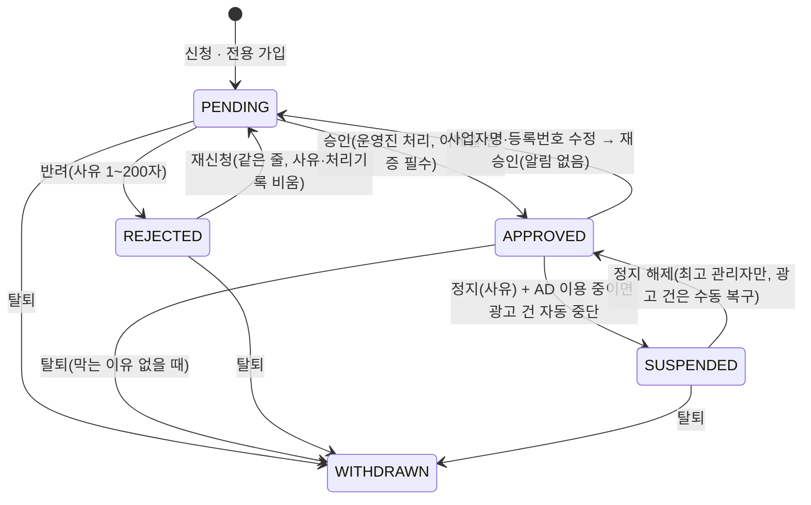

# 사업자등록 영역 분석 — 커뮤니티 → 로보얌 이식 (2026-10-30)

근거 표기: `C:파일:줄` = 커뮤니티(`D:\project\community\workspace\community`), `R:파일:줄` = 로보얌(`D:\project\roboyam`). 광고·핫딜 내부는 다루지 않고 사업자와 맞물리는 지점만 적는다.

## 1. 커뮤니티 설계 요약

### 1-1. 개념
- **사업자 = 신원 1줄(`business_profiles`) + 서비스별 이용 권한 N줄(`business_services`)**. 신원 승인은 한 번, 핫딜·직접홍보·광고는 서비스마다 켜고 끈다(`C:docs/plans/ad-business-03-business-scheduled-menu.md:6,21-25`, `C:docs/api-business-services.md:1-11`).
- **계정이 생기는 두 길**: ① 일반 회원이 사업자 신청(계정 구분 `USER` 그대로, 일반 활동 계속) ② 사업자 전용 계정 가입(`users.role = BUSINESS`, 소셜 없음, 가입 즉시 로그인, 인증 메일 발송)(`C:docs/api-business.md:12-14,53-55`, `C:server/api/.../business/service/BusinessService.java:90-105`).
- **사업자 전용 계정의 제한**: 읽기·프로필·알림·설정·쪽지 받기만 되고 일반 게시판 글·댓글·추천·투표·소모임·쪽지 발송·출석·포인트는 `403 BUSINESS_ACCOUNT_RESTRICTED`. 예외는 핫딜·직접홍보 게시판 댓글(`C:docs/api-business.md:106-123`, `C:server/shared/.../business/service/BusinessWritePolicy.java:33-37`). 운영진이 될 수 없다.
- **이용 자격 판정 한 곳**: `BusinessWritePolicy.approvedProfileOf(userId, service)` = 신원 `APPROVED` 그리고 그 서비스 줄 `APPROVED`. 신원 정지는 서비스 줄에 쓰지 않고 계산으로 막는다(`C:server/shared/.../BusinessWritePolicy.java:47-49`, `C:docs/api-business-services.md:3절`).
- **민감정보**: 사업자등록번호·대표자·연락처는 AES-256-GCM 암호문(`v1:`)만 저장, 같은 번호 비교는 키 있는 HMAC 해시(`registration_no_hash`), 끝 4자리는 평문 열. 응답은 서버가 복호화 뒤 가린 값만. 평문은 최고 관리자의 `reveal`만, 열람 기록 + 운영 로그를 같은 트랜잭션에 남긴 뒤 반환, 10분 뒤 화면이 다시 가림(`C:docs/api-business.md:34,139-144,180-187`, `C:server/shared/.../BusinessReviewService.java:253-270`).
- **누가 무엇을**: 운영진(메뉴 `BUSINESSES` 처리) = 승인·반려·정지·서비스 켜기/끄기/승인/반려/정지. **최고 관리자만** = 정지 해제·평문 열람·서비스 정지 해제·서비스 이용 규칙(`C:docs/api-business.md:17-19,146-148`, `C:docs/api-business-services.md:5-4,5-5`). 사업자 본인 = 신청·재신청·정보 수정·광고 서비스 이용 시작(`C:docs/api-business-services.md:10절`).

### 1-2. 테이블 (`C:server/shared/.../db/migration/shared/V36__business.sql`, `V103__business_services.sql`)
| 표 | 핵심 칸 | 제약 |
|---|---|---|
| `business_profiles` | `user_id UNIQUE`, `status`, `business_name ≤60`, `registration_no_enc/_hash/_last4`, `representative_enc`, `contact_phone_enc`, `contact_email`(평문), `site_url`, `categories text[]`, `reviewed_by/at`, `reject_reason`, `suspended_reason` | 상태 5개 CHECK, 살아 있는 줄은 암호문·해시 필수(`V36:38-40`, V103에서 분야 0~3개로 완화 `V103:40-43`), 탈퇴 줄은 모두 NULL(`V36:41-43`), 사유는 그 상태일 때만(`V36:45-46`), **부분 유니크 색인** `(registration_no_hash) WHERE status IN (PENDING,APPROVED,SUSPENDED)`(`V36:48`) |
| `business_view_logs` | `business_id`, `viewer_id`, `viewed_at` | 사유 칸 없음(`V36:55-61`) |
| `business_services` | `business_id`, `service[HOTDEAL·PROMO·AD]`, `status[REQUESTED·APPROVED·SUSPENDED·ENDED]`, `reason`, `requested_at`, `reviewed_by/at` | `UNIQUE(business_id, service)`(`V103:12-25`) |
| `business_service_rules` | `service PK`, `review_required` | 시드 없음, 없으면 설정 파일 기본값(`V103:30-35`) |

### 1-3. 상태 전이

서비스 줄: `(없음|ENDED) → APPROVED`(켜기) · `REQUESTED → APPROVED|ENDED`(승인·반려) · `APPROVED → ENDED`(끄기, 진행 건 있으면 `409 BUSINESS_SERVICE_IN_USE`) · `APPROVED ↔ SUSPENDED`(정지·해제)(`C:docs/api-business-services.md:5-4`). 신원 승인 때 `REQUESTED` 줄은 규칙이 "즉시 승인"이면 함께 `APPROVED`(`C:server/shared/.../BusinessReviewService.java:186-199`).

### 1-4. 사업자가 다른 서비스와 맞물리는 지점
| 사건 | 핫딜 | 직접홍보 | 광고 | 근거 |
|---|---|---|---|---|
| 신원 정지 | 구획 캐시 비움, 노출만 멈추고 기간은 흐름 | 한 줄 광고 캐시 비움 | `AD` 줄 APPROVED면 진행·예약 건 `TAKEN_DOWN`(사유 "사업자 정지") | `BusinessReviewService.java:215-230`, `C:docs/api-hotdeal-business.md:210` |
| 정지 해제 | 자동 복귀 | 자동 복귀 | 되돌리지 않음(운영팀 건별) | `BusinessReviewService.java:233-243` |
| 탈퇴 막기(우선순위) | 미결 주문 → 쓸 수 있는 입점권 → 안 끝난 노출 | 심사 중·승인 홍보 | 진행·예약 광고 | `C:server/api/.../BusinessWithdrawalGuard.java:64-86`, `WithdrawalService.java:236-241` |
| 탈퇴 실행 | 주문의 사업자 암호문 스냅샷 삭제 | — | 신청됨 건 자동 취소, 광고주 연결 끊음 | `BusinessCleanupService.java:44-69` |
| 서비스 끄기 전 영향 건수 | `placements` | `running·pending` | `running·scheduled·pending·takenDown` | `C:docs/api-business-services.md:5-3` |

## 2. 실제 구현 수준

| 항목 | 수준 | 근거 |
|---|---|---|
| 신청·전용 가입·수정·내 상태·재승인 | **구현됨**(시험 `BusinessApiIntegrationTest` 등) | `BusinessService.java` 전체 |
| 관리자 승인·반려·정지·해제·평문 열람·열람 기록 | **구현됨** | `BusinessReviewService.java`, 운영 로그는 라우트 표 `C:server/admin/.../config/AdminRoutes.java:273-284` |
| 서비스별 이용 권한(켜기·끄기·승인·반려·정지·규칙·영향 건수) | **구현됨** | `C:server/admin/.../BusinessServiceAdminService.java:96-204`, V103 |
| 사업자 센터 "이용 중 서비스"·광고 이용 시작 | **구현됨** | `C:server/api/.../BusinessServiceCenter.java`, `C:docs/api-business-services.md:10절` |
| 탈퇴 가드·정리(광고 포함) | **구현됨** | `BusinessWithdrawalGuard.java`, `BusinessCleanupService.java` |
| 관리자 앱 "신청 들어옴" 알림 | **구현됨** | `C:server/shared/.../adminnotification/entity/AdminNotificationKind.java:20`(`BUSINESS_APPLIED`), `BusinessService.java:103,133,141,177` |
| 핫딜·직접홍보 서비스의 사업자 **직접 신청 화면**, 분야 칸 필수→선택 화면 | **문서만(v0.2 예정)** — 지금은 옛 신청 길이 두 서비스를 자동 `REQUESTED`(`requestLegacyPair`) | `C:docs/specs/BIZ-001-3.md:12-14`, `BusinessService.java:138,229` |
| 탈퇴 막힘 안내 화면(사업자 쪽) | **문서만** | `C:docs/specs/BIZ-001-3.md:12` |
| 등록번호 **진위 확인(국세청)** | **미구현·미설계**(체크섬만) | `C:docs/api-business.md:43`, grep 결과 없음 |
| 통신판매업 신고번호(사업자 쪽) | **없음** — 사이트 자신의 정보에만 있음 | `C:V44__commerce.sql:29-35` |

문서 ↔ 코드 차이: ① 문서 "분야 1~3개 필수"(`C:docs/api-business.md:39`) vs 코드·DB는 0~3개 허용, 1개 이상은 핫딜 켤 때만 검사(`V103:40-43`, `BusinessServiceAdminService.java:248`). ② 문서 `business_services` 복합 PK 제안(`plans/03:21`) vs 실제 대리 키 + UNIQUE(`V103:12-25`). ③ 문서 "운영 로그는 서비스가 직접 남김"(`api-business.md:186`)은 `reveal`만 해당, 나머지는 라우트 표 인터셉터(`AdminRoutes.java:273-284`). ④ `hotdeal.md:50` "승인 후 사업자명·번호 변경 → 재승인(제안)"은 코드에서 확정 동작(`BusinessService.java:173-176`).

## 3. 보완점

| 심각도 | 문제 | 근거 | 제안 |
|---|---|---|---|
| 🔴 | **등록번호 진위·휴폐업 확인이 없다** — 체크섬만 맞으면 통과. 가짜·폐업 번호로 승인 가능, 운영자가 눈으로 판단 | `api-business.md:43`, `BusinessInputs.java:169` | 국세청 「사업자등록정보 진위확인 및 상태조회」(공공데이터포털, 무료 키) 호출을 **승인 단계**에 둔다: 상태(계속/휴업/폐업)·과세유형·대표자 일치 여부를 심사 화면에 표시하고 결과 스냅샷(조회 시각·상태코드)을 저장. 신청 시점은 체크섬만(서비스 장애가 신청을 막지 않게). 폐업이면 승인 단추 잠금 |
| 🔴 | **증빙 서류(사업자등록증 사본) 첨부가 없다** — 텍스트 입력만 | `api-business.md:24-39` | 신청 폼에 등록증 이미지/PDF 1장(선택→정책에 따라 필수) 첨부. 암호화 저장소에 두고 평문 열람과 같은 규칙(열람 기록)으로 본다. 심사 끝나면 N일 뒤 파기(개인정보 최소 보유) |
| 🔴 | **정지 해제·평문 열람이 "최고 관리자(루트)"에 묶임** — 로보얌은 루트 1명이라 운영이 막힌다 | `BusinessReviewService.java:235,254`; 로보얌 `R:docs/domain/operator-permissions.md:16` | 로보얌 권한 카탈로그로 푼다: `business.reveal`(SENSITIVE)·`business.unsuspend`(SENSITIVE)를 새로 두고 역할에 준다(이미 `BUSINESS_READ/MANAGE` 자리가 있다 `R:server/shared/.../permission/entity/Permission.java:116-117`) |
| 🟠 | **열람 기록에 사유가 없고 IP도 없다** | `V36:55-61`, `BusinessViewLogEntity.java` | 로보얌 배송지 열람 패턴을 그대로 쓴다: 사유 필수 + 운영자 ID + IP(`R:server/admin/.../GroupBuyOrderAdminFacade.java:225-229`, `R:V102__group_buy_fulfillment.sql:181-191`) |
| 🟠 | **개인정보 보유 기간·파기 정책 없음** — 반려된 신청의 암호문이 영구 보존, 심사 기록 보존 기간 미정 | `V36`에 파기 규칙 없음; 로보얌은 보존 배치가 있음 `R:docs/domain/commerce.md:788` | 반려 후 N일(제안 90일) 지나면 암호문·해시 파기(상태·사업자명·끝4자리만), 승인 사업자는 탈퇴 때 파기(지금과 같음), 세금계산서 근거(사업자명·끝4자리)는 전자상거래법 5년 보존. `R__batch_*` DB 배치로 |
| 🟠 | **승인 뒤 사업자명·번호 수정 → 조용히 재승인 대기** — 사업자에게 알림 없음, 그동안 핫딜 새 게시가 막히는데 이유를 모름 | `api-business.md:97,129`, `BusinessService.java:173-179` | 수정 전 확인 창("이 두 칸을 바꾸면 다시 심사받아요") + 저장 뒤 사업자 알림(`BUSINESS_REVIEWED` result `REAPPROVAL_PENDING`) |
| 🟠 | **반려·정지 사유가 자유 글만** — 통계·재신청 안내가 어렵다 | `BusinessReviewService.java:325-335` | 사유 코드(번호 불일치·서류 미비·폐업·정책 위반·기타) + 자유 글. 사업자 화면에 "고쳐야 할 것" 안내 |
| 🟠 | **정지·탈퇴 때 세금계산서·주문 기록 연계가 핫딜 쪽에만** — 사업자 영역에 "사업자 증빙 보기"가 없다 | `C:docs/hotdeal.md:52`, `BusinessCleanupService.java:49-50` | 사업자 상세에 "거래 요약"(주문 수·세금계산서 상태) 읽기 칸만 두고 상세는 핫딜·커머스 화면 링크 |
| 🟠 | **관리자 대행 등록이 없다** — 운영팀이 메일로 받은 사업자를 대신 등록할 길이 없다(광고는 대행 등록 있음 `plans/03:7`) | `api-business.md` 전체 | 관리자 "사업자 직접 등록"(회원 선택 + 사업자 정보 입력 + 즉시 승인 가능, 운영 로그 `BUSINESS_CREATE_BY_OPERATOR`) |
| 🟡 | **동시성 — 신청·수정이 `FOR UPDATE`로 잠그지만 승인 쪽 이메일 인증 확인은 잠금 밖 조회** | `BusinessReviewService.java:190-192` | 사용자 줄도 함께 읽거나 승인 트랜잭션 안에서 재확인(실질 위험 낮음) |
| 🟡 | **알림 종류가 하나(`BUSINESS_REVIEWED`)에 결과를 payload로 넣음** — 로보얌 회원 알림은 이벤트마다 카탈로그·끄기 가능 여부가 코드 | `api-business.md:127-131`; `R:server/shared/.../membernotification/entity/MemberEvent.java:30-51` | 로보얌식으로 `BUSINESS_APPROVED`·`_REJECTED`·`_SUSPENDED`·`_UNSUSPENDED`·`_SERVICE_*`·`_REAPPROVAL_PENDING` 이벤트를 각각 등록(계정 알림 = 끌 수 없음) |
| 🟡 | **운영자 알림이 신청 접수 하나만** — 재승인 대기·서비스 신청(심사 필요)·정지된 사업자의 광고 중단 결과를 운영자가 모른다 | `AdminNotificationKind.java:20` | 관리자 알림 이벤트 `BUSINESS_APPLIED`·`BUSINESS_SERVICE_REQUESTED`·`BUSINESS_REAPPROVAL` 3개 |
| 🟡 | **사업자 약관·개인정보 수집 동의가 없다** — 사업자 정보(대표자 성명·연락처)는 별도 수집 항목인데 일반 약관 3개만 | `api-business.md:53`, `C:frontend/app/pages/business/signup.vue:277` | 로보얌 약관 종류에 `BUSINESS`(사업자 이용약관) 추가(`R:docs/features/terms-contract.md:7` 지금은 `TERMS·PRIVACY`), 신청 폼에 동의 버전 저장 |
| 🟡 | **감사 로그가 "실패한 요청은 남기지 않음"** — 권한 없는 열람 시도가 기록되지 않음 | `api-business.md:178` | 로보얌 `PERMISSION_DENIED` 감사(`R:server/shared/.../audit/dto/AuditActions.java:19`)가 이미 있어 자동 해결. 열람 거부는 별도 액션 불필요 |
| 🟡 | 사업자 전용 계정은 `users.role=BUSINESS`인데 로보얌 `Role`은 `USER`만, 회원 유형은 "회원 역할"로 설계됨 | `R:server/shared/.../user/entity/Role.java`, `R:docs/domain/operator-permissions.md:103` | 아래 5절 — `role` 대신 회원 역할(회원 유형 = 사업자 회원)로 |

## 4. 프로세스 끊김 점검

| # | 단계 | 입력 | 상태 | 권한 | 알림 | 실패 처리 | 끊긴 곳 |
|---|---|---|---|---|---|---|---|
| 1 | 일반 회원 신청 | 사업자 7칸 | NONE→PENDING, 서비스 HOTDEAL·PROMO `REQUESTED` | 회원 + 이메일 인증 + 정지 아님, 운영자 불가 | 운영자 `BUSINESS_APPLIED` / 사업자 없음 | 400 fields·409 중복·409 이미 있음 | 사업자에게 "접수됐어요" 알림·메일 없음. 증빙 첨부 없음. 어떤 서비스를 원하는지 묻지 않음(둘 다 자동 신청) |
| 2 | 전용 계정 가입 | 계정 4칸 + 사업자 7칸 | 가입 즉시 로그인, `emailVerified=false`, PENDING | 비로그인 | 인증 메일 | 한 트랜잭션, 계정 오류+사업자 오류 합침 | 인증 전 승인 불가는 맞지만 **인증 안 하고 방치된 신청의 정리 규칙 없음**(대기 목록에 쌓임) |
| 3 | 심사 | 목록 탭·검색(번호 해시·끝4·이름) → 상세(가린 값) → 승인/반려 | PENDING→APPROVED/REJECTED | `BUSINESSES` 처리 | 사업자 `BUSINESS_REVIEWED` | 409 상태 불일치·409 이메일 미인증 | **판단 근거가 없다**(진위 조회·서류 없음, 평문은 루트만 봄 → 운영진은 가린 번호로 심사) |
| 4 | 서비스 이용 시작 | 핫딜·홍보는 신청 때 자동, 광고는 센터 [이용 시작] | 규칙 "즉시 승인"이면 APPROVED, "심사 필요"면 REQUESTED | 신원 APPROVED | 서비스 알림(ENABLED·APPROVED…) | 409 상태·409 분야 0개 | 핫딜·홍보를 **나중에 새로 신청하는 길이 없음**(끈 뒤 되살리기는 운영팀만, `api-business-services.md:10-2`) |
| 5 | 정보 변경 | 수정 폼(세 민감 칸은 비움=유지) | 명·번호 바뀌면 APPROVED→PENDING | 본인, PENDING/APPROVED만 | **없음**(사업자·운영자 모두 — 운영자는 `UPDATE` 접수 알림만) | 400·409 중복 | 재승인 중 핫딜 글쓰기 막히는 이유 안내 없음(3절 🟠) |
| 6 | 정지 | 사유 | APPROVED→SUSPENDED, AD 건 TAKEN_DOWN | `BUSINESSES` 처리 | 사업자(사유 포함) | 409 | 정지 중 **사업자가 소명·문의할 길 없음**(연락처만 화면에). 정지 기간 개념 없음(무기한) |
| 7 | 복구 | — | SUSPENDED→APPROVED | **루트만** | 사업자 | 409 | 로보얌 구조에서 막힘(3절 🔴). 중단된 광고는 운영팀이 건별 복구 — 사업자 화면에 "복구 요청" 없음 |
| 8 | 탈퇴 | 탈퇴 요청 | 가드 → WITHDRAWN(암호문 삭제) | 본인 | 없음 | 403 `WITHDRAW_NOT_ALLOWED` + 이유 코드 5종 | **사업자 쪽 안내 화면 미구현**(`BIZ-001-3.md:12`); 로보얌에는 공개 탈퇴 API 자체가 아직 없다(`R:docs/features/member-account-contract.md:64`) |
| 9 | 반려 후 재신청 | 민감 3칸 새로 입력, 나머지 채워짐 | REJECTED→PENDING 같은 줄, 서비스 둘 다 REQUESTED | 본인 | 운영자 `APPLY` | 409 중복 | 반려 사유에 "무엇을 고치면 되는지" 구조화 없음. 반려 뒤 재신청 횟수·간격 제한 없음(스팸 가능) |
| 10 | 일반 회원 ↔ 사업자 전환 | 길 ①은 `USER` 유지로 "전환" 개념 없음. 전용 계정→일반 회원 전환 불가 | — | — | — | — | 전용 계정이 사업을 그만두면 **탈퇴만** 가능. 게시판 매니저·스텝은 사업자 전환 시 자동 해제(`R:operator-permissions.md:46`) — 길 ①에서는 승인 시점에 해제해야 하는데 커뮤니티엔 없음 |
| 11 | 운영자 대행 등록 | — | — | — | — | — | **없음**(3절 🟠). 광고만 대행 등록 있음 |

## 5. 로보얌 이식 방향

### 5-1. 재사용할 것
| 로보얌 기존 | 쓰는 곳 | 근거 |
|---|---|---|
| 권한 카탈로그 `BUSINESS_READ`·`BUSINESS_MANAGE`(BIZ_REVIEW, featureReady=false) | 목록·상세 / 승인·반려·정지·서비스 처리 → `featureReady=true`로. **추가** `business.reveal`·`business.unsuspend`(SENSITIVE)·`business.settings`(서비스 이용 규칙, CONFIG) | `R:Permission.java:116-117`, `R:operator-permissions.md:83`(역할 유형 "사업자·광고") |
| `DataCipher`(AES-GCM, `d<ver>:`, `DataPurpose` AAD, 키 교체 배치) | 등록번호·대표자·연락처 암호화. 커뮤니티 `SecretCipher.blindIndex`(HMAC) 상당 메서드는 `DataCipher`에 추가 필요(확인: 현재 blind index 없음) | `R:server/shared/.../zconfiguration/crypto/DataCipher.java` 머리 |
| 배송지 열람 모델(사유·운영자·IP·`hideAt`, `commerce_address_views`) | `business_profile_views(kind REVEAL, reason, operator_id, ip)` 같은 모양 | `R:V102:181-191`, `R:GroupBuyOrderAdminFacade.java:225-229` |
| 탈퇴 회원 최소 식별정보 분리 보관(`withdrawn_member_contacts`) + 열람 | 탈퇴 사업자의 세금계산서 근거(사업자명·끝4) 보관 방식 참고 | `R:docs/domain/commerce.md:843`, `R:server/admin/.../withdrawal/service/WithdrawnContactAdminService.java` |
| 본인인증(포트원, `/api/identity-verifications`) | 사업자 신청 전 **대표자 본인인증 요구 여부**(6절 Q4) — 신청 자격에 `verified` 추가 가능 | `R:server/api/.../identity/controller/IdentityVerificationController.java`, `R:commerce.md:581-588` |
| 회원 알림 카탈로그 `MemberEvent`(끄기 잠금 `ACCOUNT`) · 관리자 알림 `NotificationPublisher`(업무 트랜잭션 참여) | 사업자 알림 6~8종, 운영자 알림 3종 | `R:MemberEvent.java:30-51`, `R:docs/features/notification-contract.md:결정 5` |
| 감사 `AuditActions` + `PERMISSION_DENIED` | `BUSINESS_APPROVE…REVEAL`, `BUSINESS_SERVICE_*`, `BUSINESS_RULE_UPDATE` 상수 추가 | `R:AuditActions.java:14-29` |
| 약관(`terms_versions`, 종류별 버전) | 종류 `BUSINESS` 추가, 신청 폼 동의 버전 저장 | `R:docs/features/terms-contract.md:7,57` |
| 회원 역할 "회원 유형: 사업자 회원" | `users.role=BUSINESS` 대신 **회원 역할 부여**로 표현(승인 시 자동, 정지·탈퇴 시 해제). 사업자 전용 계정 제한(글쓰기 불가)은 회원 역할의 능력 단위로 | `R:operator-permissions.md:103-108`, `R:Role.java` |
| 커머스 사이트 사업자 정보(`commerce_business_info`, 통신판매업 번호) | 사이트 자신의 정보 — 사업자 회원 표와 섞지 않음. 세금계산서 발행 쪽(핫딜 영역)이 쓴다 | `R:commerce.md:659,713` |
| admin-web 패턴: `Tabs` 상태 탭 + `lazy DataTable` + 행 클릭 `Drawer` + 짧은 입력 `Dialog` + `useConfirmDialog` | 사업자 목록·상세 | `R:apps/admin-web/app/pages/group-buy-requests.vue:28-37,97,132,178`, `members/index.vue:30-37,139` |
| i18n 레이어(`@roboyam/i18n`) | 모든 문구 키로 | `R:CLAUDE.md` 구조 |

### 5-2. 새로 만들 것
- 표: `business_profiles`·`business_services`·`business_service_rules`·`business_profile_views`(사유·IP) · **`business_verifications`**(국세청 조회 스냅샷) · **`business_documents`**(등록증 파일 참조) · `business_terms_agreements`(또는 users 쪽 동의 기록 재사용).
- 서버 shared: 엔티티·저장소·`BusinessInputs`(체크섬·정규화)·`BusinessWritePolicy`(자격 한 곳)·`BusinessReviewService`·외부 진위확인 클라이언트(인터페이스 + 포트원식 Fake, dev·prod에서 Fake 기동 차단 패턴 재사용 `R:commerce.md:588`).
- 서버 api: 신청·수정·내 상태·서비스 신청(핫딜·홍보도 직접 신청), 탈퇴 가드 연결점(공개 탈퇴 API가 생길 때 `blockedReason` 훅 — 커머스 「탈퇴 대비」와 합류).
- 서버 admin: 목록·상세·처리·열람·대행 등록·서비스 규칙·대시보드 칸, `AdminScreenRegistry`에 묶음 "사업자" 추가(`R:AdminScreenRegistry.java:39-135` 현재 없음).
- 화면: 7절.

### 5-3. 마이그레이션 스트림
- **shared**(V111~): 모든 사업자 표 + 회원 역할 "사업자 회원" 시드 + 약관 종류 CHECK 확장(api·admin 둘이 읽는다). 보존·파기는 `R__batch_*` 반복 마이그레이션(DB 배치).
- **api**: 없음(스트림이 비어 있다 — 사업자 표는 admin도 읽으므로 shared).
- **admin**: 관리자 메뉴·알림 이벤트 시드가 DB 시드 방식이면 여기(현재 레지스트리·카탈로그는 코드가 원천이라 없을 가능성 큼).

### 5-4. 단계
- **1차(신원 + 심사 + 열람)**: 일반 회원 신청(증빙 첨부 포함) → 운영자 심사(진위조회 결과 표시) → 승인·반려·정지·해제(권한 코드로) → 사업자 알림 → 평문 열람(사유·기록) → 사업자 센터 홈(상태·수정·재신청). 서비스 줄 표는 만들되 핫딜 하나만 켜기/끄기. 사업자 전용 계정 가입은 **보류**(Q1).
- **2차(서비스별 권한 + 연계)**: 직접홍보·광고 줄, 서비스 이용 규칙, 사업자가 서비스 직접 신청, 정지·탈퇴 때 다른 영역 연계(가드 훅·영향 건수), 운영자 대행 등록, 보존·파기 배치, 사업자 약관.

## 6. 사용자가 정해야 할 질문 (추천안 포함)

1. **사업자 전용 계정(가입 길 ②)을 로보얌에도 두나?** 추천: **1차 보류, 길 ①만**. 로보얌 회원 역할 모델("사업자 회원" 유형)과 맞고, 전용 계정의 글쓰기 제한은 회원 역할 능력으로 같은 효과. 필요해지면 "가입 → 즉시 신청" 흐름으로 추가.
2. **등록번호 진위 확인을 어디까지?** 추천: **승인 단계에 국세청 상태조회(휴폐업·과세유형) 필수 표시**, 신청 단계는 체크섬만. 키 없으면 "조회 불가" 배지로 수동 승인 허용(설정으로 강제 가능).
3. **등록증 사본 첨부는 필수인가?** 추천: **필수**(국세청 조회가 대표자 성명 일치를 100% 주지 않음). 승인·반려 후 90일 뒤 파일 파기.
4. **대표자 본인인증(포트원)을 신청 조건으로?** 추천: **2차에 선택 설정**. 1인 사업자는 유용하지만 법인 대표가 직접 인증하지 않는 경우가 많다.
5. **정지 해제·평문 열람 권한을 누구에게?** 추천: 역할 유형 "사업자·광고"의 **SENSITIVE 권한 2개**(`business.reveal`·`business.unsuspend`) — 루트 외 운영자도 역할로 받을 수 있게.
6. **반려·정지 사유 구조화?** 추천: **사유 코드 5종 + 자유 글**, 재신청은 반려 후 **하루 3회** 제한.
7. **승인 후 사업자명·번호 변경 = 재승인**을 유지하나? 추천: **유지 + 사전 확인 창 + 알림**. 대안은 "변경 요청"을 별도 줄로 두고 승인 전까지 기존 값 유지(더 안전하지만 표가 하나 늘어남).
8. **탈퇴 사업자 보존 범위?** 추천: 사업자명·끝4자리·주문 요약을 **5년**(전자상거래법 제6조 거래기록), 그 외 암호문은 즉시 삭제(지금과 같음). 반려·미인증 방치 신청은 90일 뒤 파기.

## 7. 화면 설계 제안 (PrimeVue 5, 로보얌 패턴 기준)

### 7-1. 관리자(admin-web)
**A. 사업자 목록 `/businesses`** — 진입: 사이드바 묶음 「사업자」 › 「사업자 심사」(권한 `business.read`), 대시보드 "처리할 일" 칸의 숫자 클릭.
- 흐름: 상태 `Tabs`(심사 중·서비스 심사 대기·승인·반려·정지·탈퇴·전체, 탭에 건수 `Badge`) → 보조 필터 `SelectButton`(서비스 HOTDEAL/PROMO/AD) + `InputText` 검색(사업자명·번호 10자리·끝4) → `DataTable lazy`(행: 사업자명, 가린 번호, 신원 `Tag`, 서비스 3칸 `Tag`, 신청자, 신청일, 진위조회 `Tag`) → 행 클릭 `Drawer`.
- 왜: `group-buy-requests.vue`와 같은 "탭 + lazy 표 + 서랍" 패턴이라 운영자가 이미 아는 조작. 탭 건수는 대기열 체감. 일괄 처리는 두지 않는다(심사는 건별 판단, 커뮤니티도 범위 밖 `api-business-services.md:9절`).
- 빈 상태: 탭별 안내("심사 중인 신청이 없어요"). 오류: `Message` + 다시 시도, 필터 유지. 대기: 표 `loading` 스켈레톤.
- 민감정보: 목록에는 **가린 값만**(`124-**-***98`), 평문 칸 자체가 없다.

**B. 사업자 상세 `Drawer`**(목록에서 열림, `prefs.drawerPosition` 따라 오른쪽/아래) — 섹션 `Accordion` 또는 세로 블록 5개: ① 신원(가린 값 + [평문 보기]) ② 진위 확인(국세청 상태·조회 시각·[다시 조회]) ③ 증빙 서류(썸네일, 클릭 = 열람 기록) ④ 서비스 3카드(상태 `Tag` + 영향 건수 + [켜기/끄기/승인/반려/정지]) ⑤ 처리 기록 `Timeline`(승인·반려·정지·열람·수정).
- 흐름(승인): 서랍 열기 → ②·③ 확인 → [승인] → `useConfirmDialog`("승인하면 핫딜 서비스가 바로 켜져요") → 완료 토스트, 목록 갱신. 반려·정지는 `Dialog`(사유 코드 `Select` + `Textarea` 1~200자 + 영향 건수 `Message warn`).
- 왜 Drawer: 목록 맥락을 잃지 않고 다음 건으로 넘어가기 쉽다(심사는 연속 작업). 되돌릴 수 없는 처리와 사유 입력은 `Dialog`로 끊어 오입력을 막는다.
- 평문 보기: `business.reveal` 있을 때만 단추 노출 → `Dialog`(사유 필수 `Textarea`) → 서버 열람 기록 → 평문을 **같은 블록 안에 10분 카운트다운 `Tag`와 함께** 표시, 끝나면 자동 가림, [지금 가리기]. 복사 단추 없음. 권한 없으면 단추 대신 "열람 권한이 없어요" 짧은 안내.
- 오류: 409 상태 불일치 → "이미 바뀌었어요" + 자동 재조회. 503 키 없음 → 신원 블록에 `Message error`.

**C. 사업자 직접 등록(대행)** — 상세 서랍 밖, 목록 머리 [직접 등록] → **전체 `Dialog`**(회원 검색 `AutoComplete` → 사업자 7칸 폼 → "즉시 승인" `Checkbox`). 왜: 드물고 입력이 많아 서랍보다 집중형 모달이 맞다.

**D. 서비스 이용 규칙 `/businesses/settings`**(권한 `business.settings`) — 3행 `ToggleSwitch`(즉시 승인/심사 필요) + 저장, 충돌(409) 시 "다른 사람이 먼저 고쳤어요" + 새로 불러오기. 설정 변경 이력은 `SettingHistoryDrawer` 재사용.

**E. 대시보드 칸** — "사업자 신원 심사 N · 서비스 심사 N" 숫자 카드, 클릭하면 A의 해당 탭.

### 7-2. 사용자(user-web)
**F. 사업자 센터 홈 `/business`** — 진입: 마이페이지 메뉴(사업자 회원이면 "사업자 센터", 아니면 "사업자 신청"), 승인 알림 클릭.
- 상태별 한 화면(커뮤니티 `C:frontend/app/pages/business/index.vue:201-206`와 같은 분기): NONE = 안내 + [신청하기]; PENDING = `Message info` "확인 중" + 요약 `Card`(가린 값, 수정 불가); REJECTED = `Message warn` 사유 + [다시 신청]; APPROVED = 요약 + 서비스 3카드(상태 `Tag`, 핫딜/홍보/광고 [이용 시작] 또는 [신청]) + [정보 수정]; SUSPENDED = `Message error` 사유 + 문의 안내, 읽기만.
- 왜: 상태가 하나이므로 탭이 아니라 "지금 할 일 하나"가 위에 오는 단일 흐름이 쉽다.

**G. 사업자 신청/수정 폼 `/business/apply`** — `Stepper` 3단계(① 사업자 정보 ② 증빙 첨부 ③ 약관 동의·확인). 번호 입력은 `InputMask 999-99-99999` + 체크섬 즉시 검사 문구. 수정 모드에서는 민감 3칸이 **비어 있고 placeholder가 가린 값**("바꾸지 않으면 비워 두세요") — 커뮤니티 규칙 재사용. 사업자명·번호 칸을 바꾸면 `Message warn` "저장하면 다시 심사받아요" 즉시 표시 + 제출 전 `ConfirmDialog`.
- 오류: 서버 `fields.business.*`를 칸 아래에, 409 중복은 폼 위 `Message` + "운영팀 문의" 링크. 제출 중 단추 `loading`, 네트워크 실패는 "한 건만 만들어져요" 안내 후 다시 시도. 모바일: 단계 하나가 한 화면, 하단 고정 [다음].

**H. 서비스 신청/이용 시작 — 바텀시트(모바일)/`Dialog`(PC)** — 카드의 [신청] → 서비스 설명 + 조건(핫딜은 분야 1~3개 `MultiSelect`) → [신청하기]. 결과가 즉시 승인이면 성공 토스트, 심사 필요면 카드가 "심사 중"으로.

**I. 탈퇴 막힘 안내** — 계정 설정의 탈퇴 줄에서 `blockedReason` 코드별 문구와 **해당 화면 링크**(주문·입점권·노출·홍보·광고). 공개 탈퇴 API가 커머스 「탈퇴 대비」 범위라 그 세션과 합친다.

**J. 알림 패널** — 승인·반려·정지·해제·서비스 결과·재승인 대기 항목, 누르면 F. 사유는 알림 본문에만(푸시엔 없음 — 커뮤니티 규칙 유지).