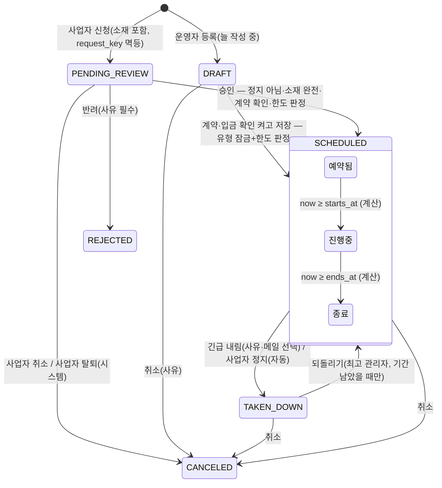

# 광고 영역 분석 — 커뮤니티 → 로보얌 이식 (2026-10-30)

경로 표기: `community/…` = `D:\project\community\workspace\community\…`, `roboyam/…` = `D:\project\roboyam\…`. 커뮤니티 서버 패키지 머리 `server/shared/src/main/java/com/community/shared/` 는 `S/`, `server/admin/src/main/java/com/community/admin/` 는 `AD/`, `server/api/src/main/java/com/community/api/` 는 `API/` 로 줄인다. 마이그레이션은 `community/server/shared/src/main/resources/db/migration/shared/` 아래 파일명만 적는다.

**한 줄 결론**: 커뮤니티 광고는 문서(`docs/plans/ad-business-01`~`07`)보다 코드가 앞서 있다 — 06 검토 뒤 D-26~D-45 결정이 나고 V99~V108 로 **광고 건·광고주·소재·처리 기록·유형 설정·자리 데이터화·한 줄 광고·사업자 신청·심사·임박 알림·글 중간 자리까지 구현·시험이 끝났다**. 로보얌 이식의 쟁점은 "무엇을 만들까"가 아니라 ① 커뮤니티의 **배치 유형+자리** 구조를 로보얌 **테마별 가젯 레이아웃**에 어떻게 얹을까 ② 사업자·핫딜·직접홍보와 어디서 합칠까 ③ 결제·집계·광고 코드 보안을 어느 단계에 넣을까다.

---

## 1. 커뮤니티 설계 요약

### 1-1. 개념
| 개념 | 뜻 | 표·코드 |
|---|---|---|
| 광고 자리 | 광고가 붙는 칸. 코드·이름·**크기 유형** `shape`(WIDE_BANNER·INLINE_ROW·RECT·SMALL_BANNER·TEXT_LINE)·배치 유형 `placements`(HOME_MOBILE·HOME_DESKTOP·GROUP_LIST·BOARD_LIST·POST_DETAIL)·받는 광고 유형·보이는 수 1~3·번갈아 방식·사용 여부·순서·글 중간 위치 `inline_after`. 자리에 넣어 둔 소재·광고 코드는 **기본 광고**(광고 건이 없을 때) | `ad_slots` — `V102`, `V108`, `S/ad/entity/AdSlotShape.java`, `AdPlacement.java` |
| 광고 유형 | 소재 규격 한 묶음. BANNER_WIDE(대·중·소 3장)·BANNER_STRIP·BANNER_RECT·BANNER_SMALL(1장)·TEXT_LINE(문구). **유형 = 크기 유형과 1:1**, 한도·기간 한도·신청 받기·글자 수는 유형 설정 | `ad_types`·`ad_settings`·`ad_application_settings` — `V99`·`V104`·`V105` |
| 광고 건 | 한 광고주의 광고 하나가 어떤 유형으로 `[시작, 끝)` 동안(분 단위). 비중 1~10. 접수 경로 STAFF/BUSINESS. 계약·입금 확인자/시각 | `ad_campaigns` — `V99`(CHECK: 예약됨·중단은 `contract_confirmed_at` 필수) |
| 소재 | 광고 건마다 한 벌(이미지 키 1~3·https 링크·대체 글·문구) | `ad_creatives` |
| 광고주 | 계정 없어도 됨. 연락처 AES 암호문, 사업자 1:1 연결(`business_id` 부분 유일) | `ad_advertisers` |
| 처리 기록 | CREATED·CONFIRMED·RESCHEDULED·UPDATED·TAKEN_DOWN·RESTORED·CANCELED·SUBMITTED·APPROVED·REJECTED(**ENDED 없음** — 종료는 계산) + 메일 상태 | `ad_campaign_events` |
| 직접홍보 | 별도 게시판 `promo` + 홍보 기간권(포트원 결제) + 신청서 → 최고 관리자 승인 → 기간 동안 글쓰기·**게시판 목록 상단·홈 한 줄**(마지막 글 제목, 동시 5) | `promo_applications`(`V47`), `community/docs/promo-board.md` |

### 1-2. 광고 건 상태 전이

- 한도를 차지하는 저장 상태 = `SCHEDULED`·`TAKEN_DOWN`(되돌릴 수 있어야 하므로). `DRAFT`·`PENDING_REVIEW`·`CANCELED` 는 차지하지 않는다.
- 변경표(`AD/ad/service/AdCampaignRules.java` `editable`): DRAFT 전부 / SCHEDULED 기간·비중·메모·링크·대체 글·이미지 / RUNNING 끝·비중·메모·링크·대체 글·이미지(시작 잠김) / TAKEN_DOWN 메모만 / ENDED·CANCELED 불변.

### 1-3. 누가 무엇을
| 행위자 | 하는 일 |
|---|---|
| 최고 관리자 | 자리 추가·중지·기본 광고·광고 코드, 유형 설정(한도·기간·신청 받기·안내 문구), **되돌리기** |
| 운영진(`ADS` 처리) | 광고주 등록, 광고 건 등록·수정·예약 확정·긴급 내림·취소, 신청 승인·반려, 연락처 열람(기록) |
| 운영진(`ADS` 조회) | 일정표·심사 목록 읽기만 |
| 사업자(사업자 센터) | 광고 서비스 이용 시작 → 유형 → 기간 → 입력 → 신청 / 신청됨일 때만 취소 / 내 광고 상태·사유·기록 |
| 시스템 | 시작·끝 계산(저장 없음), 사업자 정지 → 자동 중단, 탈퇴 → 신청 자동 취소·연락처 삭제, 나가는 자리 0곳 → 신청 받기 자동 끔, 임박 알림 배치(공개 앱, 10분) |

---

## 2. 실제 구현 수준

| 기능 | 수준 | 근거 |
|---|---|---|
| 광고 건·광고주·소재·처리 기록·유형 설정 | **구현됨** + 시험 | `V99`·`V100`, `AdCampaignsMigrationTest`, `AdAvailabilityJudgeIntegrationTest` |
| 예약 가능 판정(유형 단위 advisory lock, 반열림, 서비스 시간대, 날짜별 남은 칸) | **구현됨** | `S/ad/service/AdAvailabilityJudge.java`, `AdCampaignClock.java` |
| 번갈아 노출(배너 = 가중 무작위 하나, 한 줄 = 분 단위 회전/가중 무작위 N줄) | **구현됨** | `frontend/.../common/AdSlot.vue`, `S/ad/service/AdSlotViews.java` |
| 긴급 내림·되돌리기·취소·메일·즉시 캐시 비움 | **구현됨** | `AdCampaignAdminService`, `HomeCaches.invalidateAds` |
| 자리 데이터화(추가·중지·순서·영향 확인 토큰) | **구현됨** | `V102`, `AdSlotImpacts.java` |
| 한 줄 광고 TEXT_LINE(홈 가젯·글 중간) · 글 중간 자리 | **구현됨** | `V104`, `V108`, `api-ad-slots.md:84-101` |
| 사업자 신청·심사·`BUSINESS_AD` 알림·임박 알림 | **구현됨** | `V105`~`V107`, `AdReviewAdminService`, `AdBusinessNotices` |
| 사업자 정지 → 자동 중단 / 탈퇴 막기·신청 자동 취소 | **구현됨** | `AdSuspensionService.takeDownAll` |
| 광고 코드 허용 목록(애드센스·애드핏·쿠팡) | **구현됨** | `S/ad/service/AdCodePolicy.java` |
| 노출·클릭 집계·리포트 | **미구현**(범위 밖 명시) | `API/ad/controller/AdController.java:13` |
| 광고비 결제 | **미구현** — 사이트 밖 입금 + 체크박스 | `V99` `contract_confirmed_*` |
| 게시판 설정 "광고 한 줄 노출 안 함"(D-36) | **문서만** | 글 중간은 19금 글만 제외 |
| 핫딜 노출권 ↔ 광고 일정표 | **읽기 전용 탭만**(D-13 통합 안 함) | `admin/.../ads/AdHotdealRows.vue` |
| 직접홍보 한 줄 ↔ 한 줄 광고 | **위치 분리로 공존** | `decisions.md:685` |

06 검토 F 항목 31개 중 **남은 것**: F-07(결제 없는 승인 — 체크박스만), F-15(19금 게시판 제외 설정), F-29(집계), F-22(광고 정책·금지 품목 문서). F-02(한 줄 광고 두 벌)·F-11(심사 중 기간 지남 — 승인 거절로 처리)은 부분 해결.

---

## 3. 보완점 (로보얌 이식 관점)

| 심각도 | 문제 | 근거 | 제안 |
|---|---|---|---|
| 🔴 | **로보얌에 사업자 모듈이 없다** — 2단계(신청·심사·알림·정지·탈퇴)는 사업자 표에 묶여 있다 | `roboyam/.../Permission.java:116-117` `business.*` featureReady=false | 1차는 **운영자 대행 등록만**(광고주 = 계정 없는 행). 사업자와는 「광고주 1:1 연결」「정지 훅」「탈퇴 차단 이유」만 먼저 합의 |
| 🔴 | **광고 코드(스크립트) = XSS 표면**. 허용 목록은 있지만 CSP `script-src` 가 양쪽 다 없다(로보얌은 `frame-ancestors` 만) | `AdCodePolicy.java`, `roboyam/.../security/FrameHeaderWriter.java:15` | 1차는 **이미지 배너 + 링크만**. 광고 코드는 3차에 CSP(nonce·허용 출처)와 함께 |
| 🔴 | **소재 교체 증빙 없음** — 이미지를 바꾸면 처리 기록에 글자만, 옛 파일 키 없음 → "언제 어떤 광고가 나갔나"를 증명 못 함(표시·광고 기록 보존) | `AdCampaignAdminService.update` | `ad_creative_versions`(키·문구·링크·적용 시각) + 교체 때 옛 파일 삭제 금지 + `AuditRetention` 등록 |
| 🟠 | **노출·클릭 집계 없음** → 광고주 리포트·분쟁·정산 근거 없음. 화면이 후보 중에서 고르므로 서버는 무엇이 보였는지 모른다 | `AdController.java:13` | 1차에 최소: 노출 beacon(모아 보내기)·클릭 리다이렉트 + **일별 집계 표** `ad_daily_stats(campaign_id, day, impressions, clicks)`. 리포트 화면은 2차 |
| 🟠 | **결제 없는 승인** — 계약·입금 확인이 체크 하나, 돈 흐름이 시스템 밖 | `V99` | 로보얌엔 포트원 V2·`payment_orders`·취소 재시도·outbox 메일이 있다 → 1차 체크 유지, 2차 사업자 신청은 **선결제 + 반려 자동 환불** |
| 🟠 | **직접홍보 한 줄과 한 줄 광고 두 벌**(위치만 분리) — 운영 화면 둘, 사업자 길 둘 | `decisions.md:685` | 로보얌엔 둘 다 없으니 **광고 건 TEXT_LINE 하나로 통합**: 직접홍보 "글 기준 한 줄" = TEXT_LINE 소재 `kind=POST_LINK` |
| 🟠 | **핫딜 노출권 판정이 따로** — 같은 "기간 × 한도" 잠금이 두 벌 | `AdHotdealRows.vue` | 광고 유형 `HOTDEAL_TOP`·`HOTDEAL_CATEGORY_<말머리>`로 흡수 검토(→ 00 문서 결정 D3) |
| 🟠 | **서버 간 캐시 비움 방식이 다르다** — 커뮤니티 LISTEN/NOTIFY, 로보얌 20초 사본 폴링 | `roboyam/docs/features/site-theme-layout-contract.md:106` | 광고 응답 사본 20초 + `ads_version` 비교. "긴급 내림 뒤 최대 20초 남음"을 수용 조건으로 명시 |
| 🟠 | **배치 주인이 다르다** — 커뮤니티 api 앱, 로보얌 admin 서버(`BatchCatalog`) | `roboyam/docs/features/batch-contract.md` | `ad-reminder`·`ad-stats-rollup` 을 로보얌 배치 카탈로그에 등록 |
| 🟡 | 자리 1개 = 유형 1개라 "가로 배너를 네모 자리에도"는 두 건·두 한도 | `AdSlotShape.acceptedType()` | 신청·등록 창에 "유형마다 따로" 안내 |
| 🟡 | 19금 게시판·비공개 소모임 광고 제외 설정 미구현 | 2절 | 게시판 설정 `adsHidden`(19금 기본 켬) — `AD` 가젯·글 중간이 같이 읽음 |
| 🟡 | 되돌리기·자리·코드가 "최고 관리자" 하드코딩 | `AdCampaignAdminService.restore` | 권한 코드: `ad.read/manage/settings`·`promo.manage`(`Permission.java:122-125`) 켜고 `ad.restore`·`ad.contact.reveal`(SENSITIVE) 추가 |
| 🟡 | 광고 행위 감사 | `roboyam/.../audit/dto/AuditRetention.java` | AD_ADVERTISER_*·AD_CAMPAIGN_*(CREATE·UPDATE·CONFIRM·TAKEDOWN·RESTORE·CANCEL·APPROVE·REJECT)·AD_SLOT_*·AD_TYPE_SETTINGS_UPDATE·CONTACT_REVEAL(개인정보 2년) |
| 🟡 | 승인·반려·긴급 내림 메일이 커밋 뒤 비동기(재시도 없음) | `takeDown` `publishEvent` | 로보얌 outbox(`MailOutboxScheduler`)로 |
| 🟡 | 광고 정책·금지 품목·심사 기준 문서와 사업자 동의 화면 없음 | `decisions.md:692` | 2차 신청 마지막 단계에 「광고 정책 동의」 + 약관 종류 `AD_POLICY`(법무 뒤) |

---

## 4. 프로세스 끊김 점검

| # | 시나리오 | 커뮤니티 코드 | 끊긴 곳 / 로보얌 이식 시 주의 |
|---|---|---|---|
| P1 | 운영자 대행: 광고주 → 광고 건(작성 중) → 소재 → 계약·입금 확인 → 예약 → 시작 → 수정 → 긴급 내림 → 되돌리기 → 종료 | 닫힘 | 소재 교체 증빙 없음(🔴). 종료 뒤 광고주 통지는 운영팀이 직접 |
| P2 | 사업자 신청 → 운영팀 알림 → 심사 → 승인(한도 재판정) → 임박 알림 → 시작 → 종료 | 닫힘 | 로보얌: 사업자 모듈·회원 알림 종류(`MemberEvent` 에 BUSINESS_* 없음)·관리자 알림 이벤트 필요 |
| P3 | 반려 → 알림 → 재신청 | 닫힘(재신청 = 새 신청) | 선결제로 바꾸면 **반려 = 자동 환불**(직접홍보 `PromoAdminService.reject` 패턴: 반려 커밋 → 환불 → 실패 시 재시도) |
| P4 | 사업자가 신청됨 취소 | 닫힘 | 예약됨 이후 사업자 취소는 "운영팀 문의" — **환불 규정 없음** |
| P5 | 운영팀이 예약됨 취소 | 닫힘 | 선결제면 환불·수수료 규칙 필요 — **정책 없음** |
| P6 | 사업자 정지 → 진행·예약 건 자동 중단 → 해제 → 건마다 되돌리기 | 닫힘 | 정지 기간만큼 **연장·보상 규칙 없음** |
| P7 | 사업자 탈퇴: 진행·예약 건 있으면 막음, 신청됨 자동 취소 | 닫힘 | **로보얌 공개 탈퇴 흐름 자체가 아직 없다** |
| P8 | 자리 사용 중지(영향 N건 확인) → 마지막 자리면 신청 받기 끔 → 진행 중 건은 "어디에도 안 보이지만 한도·계약 유지" | 닫힘(기술) | 보상·연장 정책 없음(P6 과 같음) |
| P9 | 한도 줄이기 → 이미 넘친 구간의 기존 건은 그대로 | 닫힘 | 운영자에게 "넘친 구간 N개" 경고가 있는지 미확인 → 로보얌은 넣는다 |
| P10 | 직접홍보: 기간권 결제 → 신청 → 승인/반려(전액 환불)/위반 취소(환불 없음) → 노출 → 종료 | 닫힘 | 로보얌 `payment_orders` 새 용도로. 통합하면 "홍보 신청" = TEXT_LINE 광고 건 |
| P11 | 서버 2대에서 긴급 내림 즉시 반영 | LISTEN/NOTIFY | 로보얌은 20초 사본(3절) |
| P12 | 성과 리포트·정산 | 없음 | 3차. 1차 최소 집계만 |

---

## 5. 로보얌 이식 방향

### 5-1. 재사용
| 로보얌 것 | 광고에서 쓰는 법 | 근거 |
|---|---|---|
| **테마별 가젯 레이아웃** + ⚙ 설정 창(내용·모양·노출) | 커뮤니티 `AdPlacement`(HOME_MOBILE·HOME_DESKTOP·GROUP_LIST·BOARD_LIST)를 **없애고** 가젯 종류 `AD`(배너 자리 하나)·`AD_TEXT_LINE`(한 줄 N줄)을 더한다. PC/모바일 노출은 ⚙ 「노출」 탭, 빈 자리 유지/접기는 `style.empty.keep` | `roboyam/docs/features/gadget-page-contract.md`, `board-layout-contract.md`, `apps/user-web/app/components/home/HomeGadgetFrame.vue` |
| 글 중간(POST_DETAIL) | 가젯 격자로 못 그리는 유일한 위치 → 자리 설정(`inline_after`) 그대로 | `community/docs/api-ad-slots.md:84-101` |
| 권한 카탈로그 | `ad.*`·`promo.manage` 켜기 + `ad.restore`·`ad.contact.reveal` 추가. 역할 유형 「사업자·광고」 이미 설계됨 | `Permission.java:122-125`, `docs/domain/operator-permissions.md:83-85` |
| 관리자·회원 알림 | 운영자: 새 신청·긴급 내림 / 사업자: `BUSINESS_AD` 종류들 | `notification-contract.md`, `member-notification-contract.md` |
| 배치 | `ad-reminder`(10분)·`ad-stats-rollup`(하루) | `batch-contract.md` |
| 커머스 결제·환불·outbox | 2차 선결제: `payment_orders` 새 용도, 반려 환불은 취소 대기열 | `docs/domain/commerce.md` |
| 감사·보존 | `AuditActions`+`AuditRetention` | `AuditRetention.java` |
| 미디어 업로드 | 배너 이미지(JPEG·PNG·WebP, 2MB, 비율 ±3%, EXIF 제거) | `community/S/ad/service/AdBannerImageProcessor.java` |
| 관리 화면 패턴 | `PageHeader`·DataTable+Tag+Select 필터·Drawer·Dialog·`useAppToast`·`useConfirmDialog`·i18n | `apps/admin-web/app/pages/posts/index.vue` |

### 5-2. 새로 만들 것
- shared: `ad` 패키지(엔티티 + advisory lock 저장소 + 판정·시계·규칙·캐시 사본 + 집계 표), Flyway shared 1개(1차) + 1개(2차).
- api: 공개 `GET /api/ads`(사본 20초), 노출 beacon·클릭, (2차) `/api/business/ads/**`.
- admin: `/api/admin/ads/**`(광고주·광고 건·일정·자리·유형 설정·심사), 배치 등록, 알림 발행.
- user-web: `AdSlot.vue`(틀·「광고」 표시·`rel="sponsored nofollow noopener"`·가중 무작위)·`AdTextLines.vue`·가젯 2종·글 보기 끼움·(2차) 사업자 센터 광고.
- admin-web: 7절 화면 + ⚙ 설정 창에 `AD`·`AD_TEXT_LINE` 칸.

### 5-3. 단계
| 단계 | 범위 | 전제 |
|---|---|---|
| **1차** | 광고주(계정 없음)·배너 4유형·소재(이미지+링크, 코드 없음)·일정표·계약·입금 확인→예약·긴급 내림·되돌리기·취소·처리 기록·유형 설정·자리 = 가젯 `AD` + 글 중간·기본 광고(이미지만)·공개 `AdSlot`·최소 노출/클릭 일별 집계·소재 버전·감사·권한 | 없음(지금 가능) |
| **2차** | 사업자 광고 신청(선결제)·심사·알림·임박 배치·TEXT_LINE(+ 직접홍보 통합)·핫딜 노출 유형 통합(결정 시)·19금 제외·정책 동의 | 사업자 모듈, 결제 용도 확장 |
| **3차** | 광고 코드(CSP 포함)·광고주 리포트·정산·세금계산서 | 법무·광고 네트워크 정책 |

---

## 6. 결정 질문 (추천 포함)
| # | 질문 | 추천 |
|---|---|---|
| Q1 | 광고 자리 = 커뮤니티 「배치 유형+자리 표」 vs 로보얌 가젯 | **가젯 `AD`·`AD_TEXT_LINE` + 글 중간만 자리 설정** |
| Q2 | 광고 코드 1차 포함? | **3차, CSP 와 함께** |
| Q3 | 광고비 받는 방법 | **1차 입금 확인 체크, 2차 사업자 신청은 선결제·반려 자동 환불** |
| Q4 | 직접홍보 한 줄 → TEXT_LINE 통합? | **통합** |
| Q5 | 핫딜 노출권 → 광고 유형 흡수? | **흡수**(00 문서 D3) |
| Q6 | 노출·클릭 집계 1차? | **1차 최소 일별 집계**(뒤에 넣으면 과거 데이터가 없다) |
| Q7 | 되돌리기·연락처 열람 권한 | **권한 코드(SENSITIVE)** |
| Q8 | 소재 교체 증빙 | **소재 버전 표 + 파일 보존**(기간은 법무 뒤) |

---

## 7. 화면 설계 제안 (PrimeVue 5)

공통: `PageHeader`(제목·새로고침·[등록]) → 필터 줄 → 본문. 권한 없으면 단추 숨김(막는 것은 서버). 문구 `t('ad.*')`. 낙관적 잠금 409 는 `Message`(warn) + [다시 불러오기]. 서버 400 `fields.*` 는 칸 아래.

### 7-1. 관리자 `/ads` 광고 일정표 (핵심)
- 진입: 사이드 메뉴 「광고 › 일정표」(`ad.read`).
- 구성: ① `Tabs`(광고 유형별 + [핫딜 노출]) — 유형이 한도·달력의 단위라 맨 위 ② 유형 요약 띠(한도·진행·예약·신청 대기) ③ **예약 현황 달력** `DatePicker inline numberOfMonths=2` 의 날짜 슬롯에 「남은 칸」 점(0 = 꽉 참) — 운영자의 첫 질문이 "언제 비었나"이므로 ④ **광고 건 목록** `DataTable`(상태 `SelectButton`·광고주 `Select`·검색 / 열: 광고주·유형·기간(「~10/10 00:00」 반열림 표기)·상태 `Tag`·비중·접수 경로·마지막 처리). 행 클릭 → Drawer, 행 끝 `SplitButton`(상태별 긴급 내림/취소/되돌리기).
- 대행 등록 흐름: [등록] → Drawer 「기본」(광고주 `AutoComplete` + [새 광고주] Dialog·유형·비중·메모) → [작성 중 저장] → 「소재」(`FileUpload` 대·중·소, 링크, 대체 글, 옆 미리보기) → 「일정」(`DatePicker showTime` 시작·끝, 남은 칸 실시간 확인) → 「계약·입금 확인」 `Checkbox` → [예약 확정]. 꽉 차면 「일정」 위 `Message` 에 막힌 구간("10/9 10:00~15:00 은 이미 찼어요") + 달력 강조.
- Drawer 탭: 기본 · 소재 · 일정 · 미리보기(테마 틀 조각 + 「광고」 표시) · 처리 기록(`Timeline`). 상태별 잠긴 칸은 `disabled` + "이 상태에서는 바꿀 수 없어요".
- 긴급 내림 `Dialog`: 사유 필수 · 광고주 메일 `Checkbox` · "새로고침 전까지 최대 20초 남을 수 있어요" · [내리기](danger). 되돌리기·취소도 사유 Dialog.
- 빈 상태: "등록한 광고가 없어요" + [첫 광고 등록].

### 7-2. 관리자 `/ads/slots` 광고 자리
- `DataTable`: 코드·이름·크기 유형·받는 유형·보이는 수·**어디에 놓였나**(테마 레이아웃의 `AD` 가젯 수 — 0 이면 warn 「레이아웃에 없음」 + [테마 레이아웃 열기])·진행 중 건수·사용.
- [자리 추가] → Drawer(자리 정보 / 기본 광고 / 글 중간 위치). 사용 중지·유형 해제 저장 때 `ConfirmDialog` "진행 중 N건·예약 M건이 빠져요 · 마지막 자리라 신청 받기가 꺼져요".

### 7-3. 관리자 `/ads/types` 광고 유형 설정
- `Card` 기본값(최대 기간·선예약·신청 받기·안내 문구·임박 알림) + 유형 `DataTable`(한도·기간 재정의·신청 받기·나가는 자리 수). 한도를 줄이면 `ConfirmDialog` "지금 넘치는 구간 N개 — 기존 건은 그대로 나가요".

### 7-4. 관리자 `/ads/review` 신청 심사 (2차)
- `Splitter` 3단: 대기 목록(오래된 순, 「기간 지남」 Tag) · 신청 내용 + **점검표 `Checkbox` 5개**(규격·링크 열어 봄·정책 위반 없음·기간 적절·결제/계약 확인 — 모두 체크해야 [승인]) · 유형별 미리보기. 보고-대조-결정을 한 화면에서 끝내 왕복이 없다.
- 승인 `Dialog`: 기간(지났으면 고치라는 안내)·비중·메일·남은 칸. 반려 `Dialog`: 사유 필수(사업자에게 그대로) + 선결제면 환불 금액 표시·[반려하고 환불].

### 7-5. 관리자 `/ads/advertisers` 광고주
- `DataTable`(이름·사업자 연결·연락처 가림·광고 건 수·마지막 광고) + 만들기/고치기 `Dialog`. [연락처 보기] = 사유 + 감사 기록 뒤 표시. 삭제 없음.

### 7-6. 사업자 센터 `/business/ads` (2차)
- 광고 신청 `Stepper`: ① 유형 카드(어디에 나오는지 그림·남은 칸·가격) ② 기간(`DatePicker inline` 날짜별 신청 가능/꽉 참) ③ 소재 입력 + 「광고 모습 미리보기」 ④ 확인·정책 동의·결제 → 신청(멱등 키).
- 내 광고: 카드 목록(`DataView`) + 상태 `Tag`·반려/중단 사유·`Timeline`·[취소](신청됨만). 신청 받기 꺼진 유형은 흐리게 "지금은 받지 않아요".

### 7-7. 공개 화면
- `AdSlot.vue`: 크기 유형별 틀, 「광고」 표시 항상, 새 탭 + `rel="noopener noreferrer sponsored nofollow"`, 가중 무작위, 광고 없으면 `style.empty.keep` 에 따라 유지/접기, 노출 beacon 한 번, 19금·`adsHidden` 제외.
- 가젯 ⚙ 「내용」 탭: 자리 코드 `Select`(사용 중지 자리는 경고).

---

## 8. 확인하지 못한 것
- 커뮤니티 이미지 교체 때 이전 파일 삭제 여부(`AdCampaignImageService` 미열람).
- 한도 줄이기 때 운영자 경고 UI 존재 여부.
- 로보얌 `payment_orders` 용도 열 이름·확장 방식(→ 핫딜 분석은 `PaymentOrderType` + `PaymentOrderHandler` 로 확인함, 03 문서 5-1).
- 법무: 「광고」 표기 방식, 표시·광고 기록 보존 기간, 광고 네트워크 혼재 정책.
