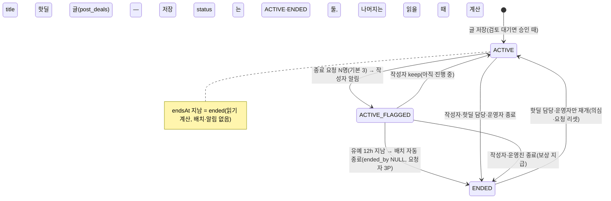
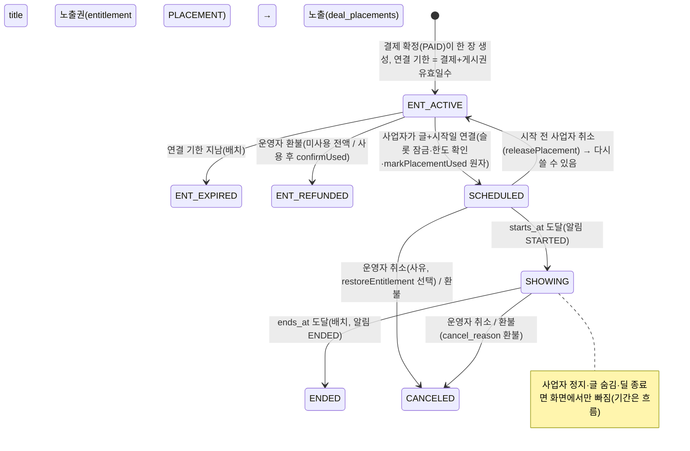
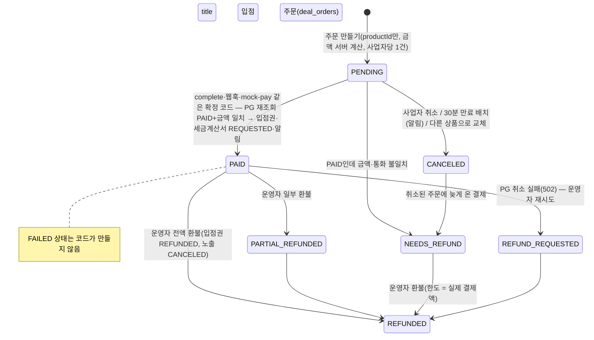

# 핫딜 영역 분석 — 커뮤니티 → 로보얌 이식

작성 2026-10-30. 근거 표기: `C/…` = `D:\project\community\workspace\community`, `R/…` = `D:\project\roboyam`. **문서와 코드가 다르면 코드를 사실로 적었다.**
먼저 바로잡을 것 하나: 커뮤니티의 「입점 상품 판매(deal shop)」는 **사업자에게 파는 디지털 이용권**(입점권·게시권·노출권·끌올권)이다. 소비자에게 물건을 팔거나 배송·반품하는 기능이 아니다(`C/docs/hotdeal.md:17` "ROBOYAM 이 직접 팔지 않는다", `C/docs/api-deal-shop.md:71-77`). 그래서 4절의 「배송→반품」 시나리오는 「입점권 사용→미사용 환불」로 바꿔 점검했다.

---

## 1. 커뮤니티 설계 요약

### 1-1. 개념과 표
| 개념 | 표 · 핵심 칸 | 근거 |
|---|---|---|
| 핫딜 게시판 | `boards.deal_enabled`(게시판 설정 데이터, slug 박지 않음), 말머리 로봇·AI·메이킹·기타, 목록 LIST(V50) | `C/docs/api-hotdeal.md:163-165` |
| 핫딜 글 | `posts` 한 줄 + `post_deals`(source MEMBER/BUSINESS, store_name, product_url, normal/deal_price, shipping_fee, coupon/discount/price_basis ≤100, starts/ends_at, stock_state, affiliate, status ACTIVE/ENDED, ended_by/at, coupon_code, business_id/name 스냅샷, product_url_key, product_host, end_flagged_at, end_flag_cleared_at) | `C/docs/hotdeal.md:31`, `C/docs/api-hotdeal-quality.md:88,122` |
| 링크 규칙 | `deal_domains(domain 유일, rule BLOCK/AFFILIATE/null, common 대형몰, note)` 접미사 일치·구체적 규칙 우선·캐시 없음 | `C/docs/api-hotdeal.md:206-209`, `quality.md:91` |
| 종료 요청 | `deal_end_requests(post_id,user_id PK, reason SOLD_OUT/PRICE_CHANGED/LINK_DEAD)` 3명→의심→12h→자동 종료, 포인트 3P | `C/docs/api-hotdeal-quality.md:22-30` |
| 위장 홍보 후보 | `deal_suspicions(user_id, domain, post_count, others_count, status OPEN/DISMISSED)` 7일 3건, 운영자 후보 목록만 | `quality.md:52-59` |
| 사업자 | `business_profiles(status)` + **`business_services(service HOTDEAL/PROMO/AD, status)`** — 신원 승인 1번 + 서비스별 권한(V103, ADM-047) | `C/server/shared/.../V103__business_services.sql:1-30` |
| 입점 상품 | `deal_products(kind MONTHLY_PASS·POST_TICKET·PLACEMENT·BUMP_PACK·PROMO, supply_price, duration_days, post_quota, slot)` 부가세는 주문 때 서버 계산 | `C/docs/api-deal-shop.md:71-77`, `api-bump.md:148` |
| 주문 | `deal_orders`(상품·사업자 스냅샷 열, 등록번호 암호문, status 8종, pg_payment_id 유일, paid/refunded_amount) + `deal_order_events`(webhook-id 유일) + `deal_refunds` + `deal_tax_invoices` + `deal_order_view_logs` | `api-deal-shop.md:331-337` |
| 입점권 | `business_entitlements(order_id 유일, kind, quota_total/used, starts/ends_at, status ACTIVE/EXPIRED/REFUNDED)` 소모는 한 문장 조건부 UPDATE | `C/.../EntitlementRepositoryQDSL.java:105`, `EntitlementService.java:56-65` |
| 노출 | `deal_placements(entitlement_id 유일, slot HOME_TOP/CATEGORY_TOP, category_prefix_id, starts/ends_at 한국 자정, status ACTIVE/ENDED/CANCELED)` 한도는 연결 시점 어드바이저리 잠금 | `C/docs/api-hotdeal-business.md` 4절, `PlacementService.java:174-185` |
| 사업자 상단 구획 | 표 없음 — 등록 24h 이내 사업자 글, 사업자당 1개, 동시 5(설정), 1분 캐시 | `C/docs/api-bump.md:140,164-167` |
| 끌올 | `posts.bumped_at`, 정렬 열 `list_id`, `post_bumps(actor_kind ADMIN/BUSINESS, free, entitlement_id)` | `api-bump.md:149-150` |
| 설정 | `deal_settings` 한 행: 하루 한도(기본 **1**), 중복 링크 일수 7, 부가세 10, 홈 상단 3·카테고리 2, 게시권 90일, 만료 임박 3일, 종료 요청 임계 3·유예 12h, 의심 3건·7일, 구획 24h·5, 끌올 3회·무료 1 | `api-deal-shop.md:277-288`, `api-bump.md:147` |

### 1-2. 누가 무엇을 하나
| 행위자 | 하는 일 |
|---|---|
| 일반 회원(일반 등급↑, 이메일 인증) | 회원 핫딜 쓰기·수정·종료, 남의 딜 종료 요청(하루 20), 추천·댓글·신고 |
| 새싹 | 읽기·댓글·추천만(`DEAL_GRADE_TOO_LOW`) |
| 승인 사업자(HOTDEAL 서비스 이용 중) | 사업자 핫딜(입점권→게시권 소모, 하루 1건, 같은 링크 7일 금지), 쿠폰 코드, 노출권 구매·글 연결·시작 전 취소, 끌올, 주문 내역·세금계산서 상태 조회. 종료 요청은 못 함 |
| 핫딜 담당(메뉴 HOTDEALS, 담당 게시판) | 글 종료·재개, 링크 규칙, 의심 후보 무시, 신고 처리(핫딜 게시판 범위) |
| DEAL_ORDERS 권한 운영진 | 주문 조회, 세금계산서 발행 표시, 노출 현황 조회 |
| 최고 관리자 | 상품·가격, 설정값, **환불**, 노출 강제 취소, 사업자 평문 열람, 매출 요약 |
| 배치(api 서버만) | 결제 전 주문 30분 만료, 입점권 만료·임박 알림, 노출 시작/종료 알림, 의심 딜 자동 종료 |

### 1-3. 상태 전이

근거: `C/docs/api-hotdeal.md:230,256-260`, `quality.md:26-29,125`.

근거: `C/docs/api-hotdeal-business.md` 4·5절, `C/.../EntitlementService.java:78-91`, `DealRefundService.java:169-170`.

근거: `C/docs/api-deal-shop.md:113-121,147-149,244-250`.

---

## 2. 실제 구현 수준

**구현됨(코드·마이그레이션·시험 있음)**: H-1 회원 핫딜(V35) · H-2 사업자(V36) · H-3 상품·결제(V37) · H-4 사업자 핫딜·노출(V38) · H-5 품질(V39) · 구획·끌올·BUMP_PACK(V47) · 목록형 전환(V50) · 서비스별 이용 권한(V103). 서버 코드 약 12,200줄, 통합 시험 51개(동시 확정·환불·노출 한도·끌올 정렬·웹훅 서명 포함). 관리자 화면 7개(`C/admin/app/pages/{hotdeals,deal-domains,deal-suspicions,deal-products,deal-orders,deal-placements,settings/deals}`), 공개 화면 핫딜 목록·쓰기·상세·사업자 센터(`C/frontend/app/pages/business/{index,deals,shop,orders,signup}`).

**문서와 코드가 다른 곳(코드가 사실)**
| 문서 | 코드 |
|---|---|
| `hotdeal.md:91` 알림에 「내 핫딜 종료(기간 만료)」 | 기간 지남은 읽을 때 계산, 배치·알림 없음(`api-hotdeal.md:230`). 알림 종류는 `BUSINESS_ORDER`·`BUSINESS_PLACEMENT`·`DEAL_END_REQUESTED` 셋(`C/.../NotificationType.java:144-154`) |
| `hotdeal.md:70` NEEDS_REFUND 사유에 「자리 없음·결제 후 사업자 정지」 | 금액 불일치·늦은 결제 둘만(`api-deal-shop.md:118-119`, `DealOrderService.java:324`). **정지 때 자동 환불 큐 없음** |
| `hotdeal.md:52,95` 사업자 하루 3건 | 기본 **1건**(V47, `api-bump.md:139`) |
| `hotdeal.md:28` 핫딜 목록 CARD | V50 이 LIST 로, 관리자가 고름(`api-hotdeal.md:163`) |
| `hotdeal.md:43-45` 사업자 권한 = `business_profiles.status` 하나 | V103 이후 「신원 APPROVED + `business_services.HOTDEAL` APPROVED」 둘 다(`BusinessDealGate.java:67`, `DealZoneRepositoryQDSL.java:57-58`) |
| `hotdeal.md:71` 세금계산서 표에 등록번호 암호문 | 암호문 스냅샷은 `deal_orders` 에(`api-deal-shop.md:349`) |
| `hotdeal.md:61` 노출권 7일 | 노출 일수 = 상품 `duration_days`, **연결 가능 기한** = 결제 + 게시권 유효일수 90(`api-deal-shop.md:160`) |
| `quality.md` 초안 `reason varchar(12)`·CHECK 식 | `varchar(16)`, CHECK 에 `IS NOT NULL` 보강, 열 `product_host` 추가(`quality.md:121-122`) |
| `hotdeal.md:66` 포트원 연동 | **실서버 호출 미검증**(키 없음, 가짜 HTTP 서버로만 — `api-deal-shop.md:62`). 가상계좌·PAY_PENDING 미구현(`:65`) |

**문서만 있고 코드 없음**: 사업자 광고 이용 정책 14절(약관·코드 없음, `hotdeal.md:124`), 제목 특수문자 검증·판매처≠신청 사이트 경고(14-2·14-5 「구현 후보」), 노출·클릭 집계(14-8), 13절 장기 항목(가격 추적·평판·자동 탐지·세금계산서 자동 발행·정기결제·사업자 통계), 법·세무 확인(12절 전부 미확인).

---

## 3. 보완점

| 등급 | 문제 | 근거 | 제안 |
|---|---|---|---|
| 🔴 | **사업자가 환불을 요청할 길이 없고, 미사용 입점권이 있으면 탈퇴도 막힌다**. 환불 API 는 운영자 전용, 사업자 센터에 요청 단추 없음 → 쓰지 않을 입점권을 산 사업자는 기간이 끝날 때까지(최대 366일) 탈퇴 불가 | `C/docs/api-deal-shop.md:24,244,303`, `C/.../BusinessWithdrawalGuard.java:81` | 사업자 센터 「환불 요청」(미사용 입점권·노출권은 자동 승인 전액, 사용분은 운영자 심사) + 「포기하고 탈퇴」 선택. 로보얌 커머스 충전 환불 규칙(`R/docs/domain/commerce.md` 9-3·17-1)과 같은 틀 |
| 🔴 | **사업자 정지·서비스 끄기 때 선결제 건 처리가 없다**. 노출은 화면에서만 빠지고 기간·입점권은 그대로 흐른다. 정지 사유가 운영 잘못이면 보상할 길이 운영자 수동 환불뿐 | `C/docs/api-hotdeal-business.md` 10절 ⑦, `BusinessImpacts.java:19-46` | 정지·끄기 창에서 영향 건수(이미 셈)와 함께 「영향 건을 환불 필요로 넘김」 선택 → `NEEDS_REFUND` 큐. 정지 해제 때 노출 기간 연장 여부 정책 결정 |
| 🔴 | **결제 코드 이중화**. 커뮤니티는 deal shop 결제·환불·웹훅을 커머스와 따로 만들었다(`DealRefundService` 자체 재시도 없음, 대사 없음). 로보얌은 `payment` 모듈(`payment_orders/cancels/events`, 재시도 큐, 대사, Fake PG, 테스트 필수)이 이미 있다 | `C/.../dealshop/payment/*`, `R/.../payment/dto/PaymentOrderType.java`, `R/docs/domain/commerce.md` 3·8절 | 입점 주문은 `PaymentOrderHandler` 구현으로 흡수(5절). 자체 PG 호출 코드는 옮기지 않는다 |
| 🔴 | **법적 지위 미확인**. ① 입점권 판매 = 로보얌이 판매자인 B2B 디지털 서비스 → 통신판매업 신고 범위·청약철회 적용 여부·약관·사업자 정보 표시 필요. ② 핫딜 글은 외부몰 링크(통신판매중개 아님)지만 사업자 핫딜·노출·구획은 광고 → 「광고」표시는 구현됨. ③ 제휴 링크 표기는 AFFILIATE 도메인 등록 + 작성자 체크에 의존 — **단축 URL·리디렉션은 못 잡는다** | `C/docs/hotdeal.md:112-118`, `DealService.java:205-208`, `DealPanel.vue:75-81`(nofollow sponsored 있음) | 법무 확인 항목 그대로 유지. 단축 URL 도메인(bit.ly·han.gl·coupa.ng 등)은 기본 BLOCK 시드; 2차에 서버가 최종 URL 을 풀어(HEAD, 3회 리디렉션) 도메인 규칙 재적용 |
| 🟠 | **회원 핫딜 중복 글 감지 없음** — 같은 상품 링크를 여러 회원이 올려도 그대로. 중복 검사는 사업자 글만(`product_url_key` 도 사업자만 채움) | `C/.../DealService.java:133,248` | 모든 글에 `product_url_key` 채우고 글쓰기 때 「진행 중 같은 딜 N건」 안내(막지 않음) + 상세에 「같은 딜」 묶음 |
| 🟠 | **가격 정확성·종료 처리의 시간 공백**. 가격 변경 이력 없음, 의심 상태 12h 유예 — 심야 품절 딜이 반나절 노출. 사업자 글 가격 수정에 제한 없음 | `quality.md:28`, `api-hotdeal.md:202` | 목록 기본 「진행 중만」 + 의심 글은 자동 하단 정렬. 사업자 핫딜은 가격·링크 수정 이력(`post_deal_revisions`) 보존 — 표시광고 6개월(`R/commerce.md` 17-3) |
| 🟠 | **노출 한도 축소 시 초과 예약 방치**. 동시성은 잠금+조건부 UPDATE 로 막혔지만, 운영자가 설정 `capacity` 를 줄이면 이미 예약된 건이 한도를 넘고 표시 때 뒷순위가 소리 없이 빠진다(환불 없음) | `PlacementService.java:174-185`, `api-hotdeal-business.md` 6절 「최대 한도 개」 | 설정 저장 때 초과 건수 경고, 초과 건은 운영자 취소(`restoreEntitlement`) 또는 한도 상향 |
| 🟠 | **신고↔제재 끊김**. 핫딜 신고 사유는 일반 글 사유 그대로(FALSE_INFO·AD), 사업자 신고 누적→서비스 정지는 수동. 종료 요청·의심 후보도 신고 화면과 별도 | `hotdeal.md:133`, `quality.md:73` | 로보얌 신고 사유에 `DEAL_FALSE_PRICE`·`DEAL_HIDDEN_AD` 추가, 신고 사건 서랍에서 「핫딜 종료」·「사업자 서비스 정지」 바로 가기. 자동 정지는 임계 설정값(0=끔) |
| 🟠 | **환불 사유가 사업자에게 가지 않는다**(알림·푸시에 금액만). 분쟁 때 근거 부족 | `api-deal-shop.md:185,246` | 환불 창에 「내부 메모」와 「사업자에게 보이는 사유」 두 칸 |
| 🟠 | **포트원 실서버 미검증·비동기 결제 미지원** | `api-deal-shop.md:62-65` | 로보얌 payment 모듈로 흡수하면 그쪽 검증(dev 배포 뒤 PG 확인 예정)에 얹힌다 |
| 🟡 | 감사: 운영자 조치는 운영 로그 있음. 사업자 본인의 노출 연결·취소·끌올은 행 기록만, 평문 열람은 열람 기록+로그 | `api-deal-shop.md:262`, `api-bump.md:149` | 로보얌 `audit.record` + `AuditActions.HOTDEAL_*`(민감: 환불·평문 열람·강제 취소) |
| 🟡 | 기간 만료 알림 없음(문서는 있음), 작성자가 만료를 모른다 | 2절 표 | 만료 글은 「기간 지남」 표시로 충분하면 생략, 아니면 하루 배치 알림 |
| 🟡 | 상품 이미지·OG 자동 채움 없음 — 핫딜 목록이 글자만 | `DealFormFields.vue`(링크 검사만) | 2차: 서버 OG 조회(허용 도메인·크기 제한·캐시) |
| 🟡 | 끌올 정렬 열 `list_id` 가 앱·DB 시계 차이에 민감(생성 열 + 파티션) | `api-bump.md` 8-1 | 로보얌 `posts` 구조 확인 전에는 끌올 보류 |
| 🟡 | 노출·클릭 집계 없음 → 광고주에게 가치를 보여 줄 수 없음 | `hotdeal.md:135` | 3차. 광고 담당의 집계 설계와 같이 |

---

## 4. 프로세스 끊김 점검

| 시나리오 | 단계 | 상태 | 끊긴 곳·비고 |
|---|---|---|---|
| **A. 회원 핫딜** | 쓰기(링크 검사→딜 칸→저장) | ✅ | 임시저장에 딜 없음, 예약 발행 불가 — 로보얌은 둘 다 없어 무관 |
| | 추천·댓글·포인트 | ✅ | 일반 글과 같음 |
| | 신고 | ⚠️ | 일반 사유만. 핫딜 전용 사유·조치 연결 없음(3절 🟠) |
| | 종료 요청→의심→keep/자동 종료→보상 | ✅ | 12h 공백은 정책값 |
| | 종료·품절 표시 / 기간 만료 | ✅/⚠️ | 만료 알림 없음, 종료 글 기본 노출(필터 `status=active` 는 선택) |
| | 재개 | ⚠️ | 작성자 불가(설계). 운영진 재개 뒤 기간 지남이면 작성자가 수정해야 함 — 안내 문구 필요 |
| **B. 사업자 핫딜** | 서비스 신청→승인 | ✅ | 사업자 담당 영역(V103) |
| | 상품 구매(입점권) | ✅ | 승인 사업자만 |
| | 글쓰기→입점권 소모(원자) | ✅ | 같은 트랜잭션, 하루 1건·중복 7일 |
| | 24h 상단 구획 | ✅ | 표 없이 계산, 1분 캐시 |
| | 노출권 구매→글 연결→SCHEDULED→SHOWING→ENDED | ✅ | 시작 전 취소만. 시작 후 사업자 사정(품절)으로 내릴 길 없음 → ⚠️ 「조기 종료(환불 없음)」 필요 |
| | 노출 중 딜 종료·글 숨김 | ⚠️ | 화면에서만 빠지고 기간 소진. 사업자 알림 없음 |
| | 입점권 만료·임박 알림 | ✅ | 배치 |
| | **미사용 입점권 환불** | ❌ | 요청 경로 없음(3절 🔴) |
| **C. 입점 주문** | 주문→결제(SDK)→complete/웹훅→PAID | ✅ | 멱등·금액 재검증. 실PG 미검증 ⚠️ |
| | 결제 전 이탈 | ✅ | 30분 만료 배치·알림 |
| | 금액 불일치·늦은 결제 | ✅ | NEEDS_REFUND → 운영자 수동. 자동 취소 없음(로보얌 커머스는 자동 취소) ⚠️ |
| | 세금계산서 | ⚠️ | REQUESTED 줄 생성→외부 발행→표시. 사업자가 「발행 요청/불필요」를 고를 수 없음, 전자세금계산서 연동 없음 |
| | 환불(전액·일부·사용 후) | ✅ | 운영자만. PG 실패 시 재시도 큐 없이 수동 ⚠️ |
| | 정산·매출 집계 | ⚠️ | 매출 요약 API 만(기간·상태 건수). PG 대사 없음 — 로보얌 `payment` 대사로 대체 |
| **D. 사업자 정지·탈퇴 중 진행 건** | 서비스 정지 | ⚠️ | 영향 건수 표시(`BusinessImpacts`)·노출 표시 중단·새 글 차단. 입점권·노출 기간은 흐름, 환불 큐 없음(🔴) |
| | 정지 중 결제 확정·취소 | ✅ | 상태 무관 허용(돈이 낀 주문 보호) |
| | 서비스 끄기 | ✅ | 끝나지 않은 노출 있으면 막음 |
| | 탈퇴 | ⚠️ | 열린 주문·쓸 수 있는 입점권·예약/노출 중이 있으면 막음. 사업자가 풀 수단은 「취소·소진·기다림」뿐(🔴) |
| | 탈퇴 후 기록 | ✅ | 주문·입점권·노출 기록 남김, 암호문 스냅샷만 삭제, `deal_end_requests` 삭제 |

---

## 5. 로보얌 이식 방향

### 5-1. 재사용(이미 자리가 있다)
| 로보얌 기반 | 어떻게 쓰나 | 근거 |
|---|---|---|
| **게시판 종류 `boards.kind = DEAL`** | 커뮤니티의 `deal_enabled` 대신 이미 예약된 DEAL 종류를 켠다(글쓰기에 딜 칸 필수·종료 규칙). `BoardFields.KIND_DEAL` 과 DEAL 게시판용 가젯 자리도 있음 | `R/.../V42__boards.sql:207,254`, `R/.../BoardFields.java:60-63,232` |
| **글 부가 표 패턴**(`post_polls`·`post_debates`) | `post_deals(post_id PK)` 를 같은 방식으로 붙인다(FK 없음, 글 저장 트랜잭션에 합류). 관리자 글 목록 칩(`poll`·`debate`)처럼 「딜」 칩 | `R/docs/features/post-poll-contract.md`, `R/apps/admin-web/app/pages/posts/index.vue:174-186` |
| **권한 카탈로그** | `hotdeal.read/manage/domain.manage`, `deal-order.read/manage/settings/refund(SENSITIVE)` 가 `featureReady=false` 로 예약돼 있다 — 이름을 새로 정하지 말고 이것을 켠다. 담당 게시판 범위는 로보얌이 뺐으니(post-admin-contract) **게시판 매니저/스텝**으로 핫딜 담당을 둔다 | `R/.../Permission.java:93-95,118-121`, `R/docs/features/post-admin-contract.md` 「community 와 다른 점」 |
| **신고** | 사건 모델·자동 숨김·사유 코드 체계에 핫딜 사유 2개 추가. 종료 요청은 신고가 아니라 **별도 가벼운 신호**로 둔다(커뮤니티 결정 유지) | `R/docs/features/report-admin-contract.md` |
| **포인트** | `PointService` 한 길 + 원장 유일 `(reason, ref_type, ref_id)` → 사유 `DEAL_END_REQUEST`(ref = 글) 추가, 하루 상한은 `point_settings` 칸 2개 | `R/docs/features/point-contract.md` 「저장」 |
| **인기글** | 사업자 글 제외는 인기글 설정의 「제외 조건」에 `post_deals.source = BUSINESS` 를 더한다(운영자 수동 제외 `popular_exclusions` 와 별개) | `R/docs/features/popular-highlight-contract.md` |
| **가젯** | 홈·가젯 페이지·게시판 레이아웃에 `HOT_DEALS`(진행 중 핫딜 N개, 정렬 설정) · `DEAL_PLACEMENT`(노출 광고, 고정 크기·「광고」표시) 가젯 추가 — 공동구매 가젯과 같은 ⚙ 설정 방식 | `R/docs/features/gadget-page-contract.md` 「가젯 설정」 |
| **결제 모듈** | `PaymentOrderType.BIZ_PRODUCT`(또는 `HOTDEAL_PRODUCT`) + `PaymentOrderHandler` 구현: `onPaid` → 주문 PAID + 입점권 생성 + 세금계산서 REQUESTED, `onCanceled` → 입점권 REFUNDED·노출 CANCELED. PG 상태·웹훅·취소 재시도·대사·결제 이상 화면은 `payment` 가 맡고 `deal_orders` 는 **도메인 주문**(상품·사업자 스냅샷·세금계산서·환불 사유)만 | `R/.../PaymentOrderHandler.java:19-32`, `R/docs/domain/commerce.md` 3절·8-2·8-3·16-1 |
| **감사·알림·탈퇴** | `audit.record(...)` + `AuditActions.HOTDEAL_*`; 회원 알림 종류 3개 추가; 탈퇴 전 검증 자리(`withdrawal` 패키지)에 사업자 막는 이유 추가 | `R/.../AddressRevealService.java:178`, `R/docs/domain/commerce.md` 17-1 |

### 5-2. 입점 판매는 로보얌 커머스로 **흡수**(추천)
- 흡수하는 것: 결제·취소·웹훅·대사·결제 이상 처리·보존 기간(5년)·**테스트 필수 규칙**(`commerce.md` 18절 — 입점 상품 주문도 「돈이 움직이는 커머스」라 같은 기준). 커뮤니티의 `PaymentGateway`·웹훅 검증기·`DealRefundService` 는 가져오지 않는다(로보얌에 같은 것이 더 완성돼 있다: 재시도 큐·대사·Fake PG).
- 별도로 두는 것: 상품 카탈로그(`biz_products` kind 5종 — 사업자·광고 담당의 PROMO·광고 상품도 같은 표를 쓰게), 입점권·노출권·주문 도메인 표, 세금계산서(수동), 사업자 평문 열람. 패키지 `com.community.hotdeal`(글·링크 규칙·품질) 과 `com.community.bizproduct`(상품·주문·입점권·노출) 둘, 의존은 `bizproduct → payment`, `hotdeal → bizproduct`(입점권 소모) 단방향.
- 이유: ① 결제 코드 하나(🔴 3번), ② 커머스 테스트·동시성 기준을 그대로 받음, ③ 로보얌 `payment_cancels` 재시도 큐가 커뮤니티의 「PG 취소 실패 → 수동」 끊김을 메움, ④ 관리자 「결제 › 주문·이상·대사」 화면이 입점 결제도 함께 보여 운영 화면이 줄어듦.
- 주의: 공구는 소비자 B2C(청약철회·에스크로), 입점권은 B2B 디지털 서비스 — **환불 규칙은 도메인 핸들러가 따로 가진다**(미사용 전액·사용 후 운영자 심사·규칙 위반 취소 시 환불 없음). 로보얌 커머스의 「늦은 결제·금액 불일치 자동 취소」는 입점 주문에도 그대로 적용(커뮤니티의 NEEDS_REFUND 수동 처리보다 낫다).

### 5-3. 새로 만들 것·단계
- **1차 — 회원 핫딜(사업자 없이 완결)**: `post_deals`·`deal_domains`·`deal_end_requests`·`deal_suspicions`(shared 스트림 V111~), DEAL 게시판 글쓰기·수정·목록 정렬(최신·인기·마감 임박)·배지·종료/재개·종료 요청·자동 종료 배치·포인트·위장 감지, 관리자 3화면(핫딜 글·링크 규칙·의심 후보), 신고 사유 2개, `HOT_DEALS` 가젯. **중복 딜 안내(모든 글 `product_url_key`)와 단축 URL 기본 차단**을 처음부터.
- **2차 — 사업자 핫딜·입점 상품**(사업자 담당의 서비스 권한 모델이 먼저): `biz_products`·`biz_orders`·`business_entitlements`·`deal_placements`·`deal_tax_invoices`, `PaymentOrderHandler`, 사업자 핫딜 쓰기(입점권 소모·하루 한도·중복), 상단 구획, 노출권 연결·표시(`DEAL_PLACEMENT` 가젯), **사업자 환불 요청·정지 때 환불 큐**(커뮤니티에 없던 것), 관리자 상품·주문·노출 현황·설정 화면, 사업자 센터.
- **3차**: 끌올(`posts` 정렬 열 검토 뒤), 쿠폰 코드, 사업자 핫딜 수정 이력, OG 이미지, 노출·클릭 집계, 전자세금계산서 연동.

---

## 6. 사용자가 정해야 할 질문

1. **입점 판매 결제를 로보얌 `payment` 모듈에 흡수할까?** — 추천 **예**(5-2). 아니면 커뮤니티 코드 이식 + 대사·재시도 따로 구현.
2. **사업자가 스스로 환불을 요청할 수 있게 할까?** — 추천 **예**: 미사용 입점권·노출권은 신청 즉시 전액 자동 승인(결제 7일 이내 조건 없이), 사용분은 운영자 심사. 탈퇴 화면에 「미사용 입점권 포기」 선택.
3. **노출권(홈·카테고리 상단)을 광고 일정표와 통합할까?** — 커뮤니티는 통합하지 않았다(ADM-045: 핫딜 노출은 읽기 전용, BIZ-001 D-22: 입점 노출권 구매 화면으로 이동만). 추천 **1차는 분리 유지, 2차에 광고 담당과 「광고 유형 HOTDEAL_TOP」 통합 여부 결정**(한도 판정 코드가 둘이 되는 문제).
4. **사업자 상단 구획·끌올을 가져올까?** — 추천 구획은 2차(계산만, 표 없음), 끌올은 3차(정렬 열이 글 표 구조를 건드림).
5. **핫딜 담당 권한 = 게시판 매니저/스텝 모델로 할까?** — 추천 **예**(담당 게시판 범위 기능을 다시 만들지 않음). `hotdeal.manage` 는 전체 핫딜 게시판.
6. **회원 핫딜 중복은 막을까, 안내만 할까?** — 추천 **안내만**(같은 링크 진행 중 딜 보여주고 그래도 올리기) + 상세에 「같은 딜」 묶음.
7. **핫딜 글에 상품 이미지(OG 자동 채움)를 넣을까?** — 추천 2차. 외부 요청·캐시·허용 도메인 설계 필요.
8. **사업자 핫딜 가격·링크 수정 이력을 6개월 보존할까?** — 추천 **예**(표시광고 보존과 분쟁 대비, 회원 글은 제외).

---

## 7. 화면 설계 제안

기준 패턴: `R/apps/admin-web/app/pages/posts/index.vue` — `FilterRow`/`FilterOptionGroup`/`DateRangeField`(공통) + `DataTable` + 행 클릭 → `Drawer`(주소 `?post=` 유지, `prefs.drawerPosition`) + 조치는 사유 `Dialog`(`PostReasonDialog`) + `useConfirm`/`useToast`. 핫딜 화면도 같은 골격으로 맞춘다. 문구는 모두 i18n 키.

### 7-1. 관리자(admin-web)
| 화면 · 진입 | 핵심 흐름(클릭 순서) | 컴포넌트 · 왜 | 빈/오류/대기 |
|---|---|---|---|
| **핫딜 글** `/hotdeals` (사이드바 콘텐츠) | 상태 `SelectButton`(진행·종료·의심) → 출처 `Select`(회원·사업자) → `InputText` 검색(제목·쇼핑몰) → 행 클릭 → Drawer(딜 카드·종료 요청 사유별 수·사업자명·신고 수) → [종료]/[재개] → `Dialog` 사유(선택) → `Toast` | `DataTable`(가격·할인율·몰·상태 `Tag`·종료 요청 `Badge`): 한 눈에 비교·일괄 선택이 쉬움. 상세는 `Drawer`: 목록 자리 유지한 채 다음 글로 넘어가며 처리(글 관리와 같은 손놀림) | 빈: 「핫딜 글이 없어요」+ 게시판 설정 링크 · 오류: `Message` 재시도 · 대기: `Skeleton` 5줄 |
| **링크 규칙** `/hotdeals/domains` | [규칙 추가] → `Dialog`(도메인 `InputText` 정규화 미리보기, 규칙 `SelectButton` 차단·제휴·없음, 대형몰 `Checkbox`, 메모) → 저장. 행 끝 [고치기]·[지우기](`useConfirm`) | 작은 표라 `DataTable` + `Dialog`(Drawer 필요 없음). 입력 즉시 「`coupang.com` 으로 저장돼요」 보여 주면 www·경로 실수가 사라짐 | 빈: 「규칙이 없으면 모든 쇼핑몰을 허용해요」 · 중복 409 는 칸 오류로 |
| **의심 후보** `/hotdeals/suspicions` | 상태 라디오(열림·무시) → 행(회원·판매처·건수·다른 회원 수) 클릭 → Drawer(글 10개 목록 `DataView`, 회원·글 바로 가기) → [무시] → `Dialog` 메모 | 처리 자체가 「보고 판단」이라 Drawer 가 맞고, 제재는 기존 신고·회원 화면으로 보내는 링크만(중복 기능 안 만듦) | 빈: 「의심 후보가 없어요」 · 탈퇴 회원은 `Tag` 「탈퇴」 |
| **입점 상품** `/biz-products` (사업자 묶음) | [상품 추가] → `Dialog`: 종류 `SelectButton`(5종) → 종류별 칸만 보이게(기간·건수·슬롯) → 공급가 입력 시 부가세·총액 자동 표시 → 저장(판매 전) → 행 `ToggleSwitch` 판매 중 | `DataTable` + `Dialog`: 상품은 적고 칸이 종류에 따라 바뀌어 한 창이 편함. 삭제는 주문 0건일 때만 보이게 | 주문 있는 상품 삭제 409 → 「판매 중단으로 바꿔 주세요」 |
| **입점 주문** `/deal-orders` (관리자 결제 › 주문과 나란히) | 상단 `Message`(환불 필요 N·세금계산서 대기 N → 누르면 필터) → 상태 `SelectButton` → 기간 `DateRangeField` → 행 클릭 → Drawer(금액·스냅샷·입점권 사용량·`Timeline` 이벤트·환불 목록) → [환불] `Dialog`(금액 `InputNumber` 기본 잔액, 「사용 후 환불」 `Checkbox` 는 사용량>0 일 때만, 내부 사유·사업자 안내 사유) → [세금계산서 발행 표시] `Dialog` 메모 → [평문 보기] `useConfirm` → 10분 `Tag` 카운트다운 | Drawer 안 `Timeline` 으로 PAID→환불→세금계산서 흐름이 읽힌다. 환불은 되돌릴 수 없어 `Dialog` + 금액 확인 문구. PG 상태는 `payments/orders` 링크로 | 빈: 「주문이 없어요」 · 502 PG 실패: `Message` 「환불 요청 상태로 남겼어요」 + 재시도 |
| **노출 현황** `/deal-placements` | 슬롯 `Tabs`(홈 상단·카테고리별) 상단에 한도 `ProgressBar`(사용/한도) → 상태 필터 → `DataTable`(사업자·글·기간·상태) → [취소] `Dialog`(사유 필수, 「노출권 돌려주기」 `Checkbox`) | 자리 상황이 핵심이라 표 위에 미터. 달력은 사업자 쪽에만(운영자는 숫자로 충분) | 한도 0: 「이 슬롯은 꺼져 있어요」+ 설정 링크 |
| **핫딜·입점 설정** `/settings/hotdeal` | 구획 4개(사업자 게시·노출 한도·종료 요청·구획/끌올) `Fieldset` → `InputNumber`(범위 도움말) → [저장] → 바뀐 칸만 감사 | 로보얌 설정 화면 패턴. 한도를 줄일 때 「예약 N건이 한도를 넘어요」 경고 `Message` | — |

### 7-2. 사용자(user-web)
| 화면 · 진입 | 핵심 흐름 | 컴포넌트 · 왜 | 빈/오류/대기 |
|---|---|---|---|
| **핫딜 목록** `/boards/{slug}` (kind DEAL) | 맨 위 「광고」 구획(사업자 글 카드 `Carousel`/가로 스크롤, 고정 높이) → 카테고리 상단 노출(있을 때) → 필터 줄: 정렬 `SelectButton`(최신·인기·마감 임박), 출처 `SelectButton`(전체·회원·사업자), 「종료 숨기기」 `ToggleSwitch`, 말머리 `Chip` → 행 | 목록형 행(`DealRowItem`): 제목 앞 `Tag`(사업자·광고 / 제휴 / 종료 / 품절 가능성), 오른쪽 가격 열(딜가 굵게·정상가 취소선·할인율) — 핫딜은 가격 비교가 목적이라 카드보다 행이 빠르다. 종료 글은 `opacity` 낮춤 | 빈: 「진행 중인 핫딜이 없어요 · 종료 글 보기」 · 새싹 글쓰기 단추 `disabled` + 툴팁 「일반 등급부터」 |
| **핫딜 쓰기** `/write?board=hotdeal` | 1 상품 링크 붙여넣기 → 디바운스 link-check → 호스트 `Tag`·「제휴 표시가 자동으로 켜져요」/「이 쇼핑몰은 올릴 수 없어요」 → 쇼핑몰 이름 자동 채움(호스트→이름 표, 수정 가능) → 2 가격(`InputNumber` 원, 정상가 입력 시 할인율 미리보기) → 배송비 `SelectButton`(무료·모름·금액) → 마감 `DatePicker`(선택) → 재고 `SelectButton` → 제휴 `Checkbox`(강제면 잠김) → 3 제목·본문 → 등록. 같은 링크 진행 중 딜이 있으면 `Message` 「이미 올라온 딜 N건」(그래도 등록 가능) | 모바일: 딜 칸을 **본문 위 `Stepper`(딜 정보 → 설명)** 로 두어 한 손 입력. 링크 하나로 몰·제휴 표시가 채워지는 것이 가장 큰 편의 | 링크 형식 오류·BLOCK 은 칸 아래 오류, 다른 칸 오류와 함께 모아 표시 |
| **핫딜 상세** `/posts/{id}` | 본문 위 딜 카드(`Panel`): 배지 줄 → 가격 줄 → 몰·배송·재고·기간·쿠폰(로그인 시 코드 `Button` 복사) → [구매하기] 외부 새 탭(`rel=nofollow sponsored`) → 아래 「품절·가격 변경을 알려 주세요」 `Button` → `Dialog`(사유 `RadioButton` 3개) → `Toast`. 작성자: [종료] `useConfirm`, 의심 상태면 상단 `Message` 「N명이 알렸어요 · 아직 진행 중이에요」 | 가장 중요한 두 행동(구매·알리기)을 카드 안에 둔다. 종료 요청 사유는 라디오만(자유 글 없음 — 악용 방지) | 종료 글: 카드 흐림 + 「종료됨/기간 종료/회원 신고로 종료」 · 비로그인 쿠폰: 「로그인하면 보여요」 |
| **사업자 센터** `/business` | 요약 카드 3개(입점권 잔여/오늘 게시 1/1·노출권 N장·끌올) → 탭: 내 핫딜 · 입점 상품 · 주문 내역 | `Card` 요약 + `Tabs`. 모바일은 `DataTable` 대신 카드 목록(`DataView`) | 승인 전: `BusinessGateNotice`(신청 상태·사유) |
| └ 내 핫딜 `/business/deals` | 상태 `SelectButton` → 행(제목·가격·추천·댓글·노출 `Tag`) → 행 메뉴 `Menu`: 종료 · **노출 연결** · 끌올(3차) → 노출 연결 `Dialog` 3단: 노출권 `Select`(슬롯·기한) → 시작일 `DatePicker`(가용 일자 `availability` 로 꽉 찬 날 비활성·점 표시) → 확인(기간·카테고리 요약) → `Toast` | 달력에 빈자리를 바로 보여 주면 `PLACEMENT_FULL` 왕복이 줄어든다(연결 시 재검사는 서버) | 노출권 없음: 「노출권 사러 가기」 · 딜 종료 글은 메뉴 비활성 + 이유 |
| └ 입점 상품 `/business/shop` → `/business/shop/{id}` | 종류별 카드 → 결제 화면: 금액 내역(공급가·부가세·총액) → **환불 정책·세금계산서 안내 `Checkbox` 동의** → [결제하기] → 포트원 SDK → 완료 → 주문 상세 | 결제 전 고지를 체크로 받아 분쟁 근거를 남긴다(`RefundPolicyNotice` 계승) | 결제 미설정: 「결제를 준비 중이에요」 · 결제 전 주문 있음: 「이어서 결제」 |
| └ 주문 내역 `/business/orders` → `[orderNo]` | 목록(상품·금액·상태 `Tag`·세금계산서 상태) → 상세 `Timeline` → [환불 요청](미사용이면 즉시, 사용분은 「운영자 확인 뒤」) `Dialog` 사유 → [영수증] | 사업자가 「내 돈이 어디 있나」를 한 줄로 보게 | 환불 요청 중: `Tag` 「확인 중」 |
| **홈·가젯** | `HOT_DEALS` 가젯(진행 중 N개, 가격 줄) · `DEAL_PLACEMENT` 가젯(「광고」 고정 크기) | 공동구매 가젯과 같은 ⚙ 설정 | 비면 영역 자체를 그리지 않음 |
